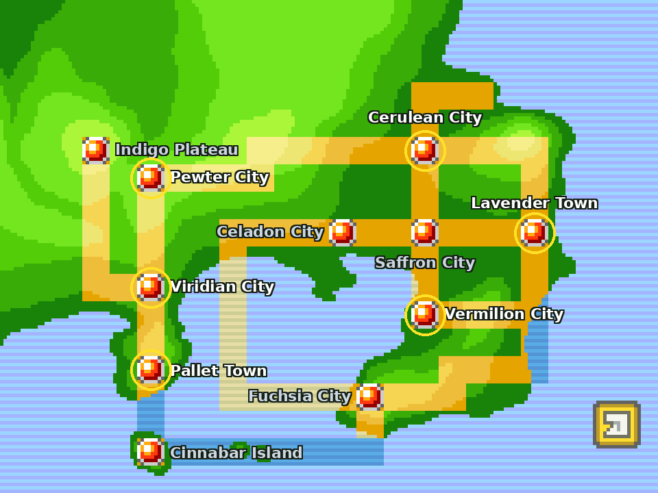

# Playing this ROM headless: a guide for agents



This is what earlier sessions learned while playing the `kanto-hoenn` build from a fresh game to
Mt. Moon with no screen and no controller: a headless emulator, scripts that read the game's RAM,
and screenshots looked at one at a time. Read it before you play. It covers setup, the tools, the
input quirks that cost time, battle tactics, and what is where on each route.

The run so far: Ethan, Pikachu start, Boulder Badge, Charmander from the Mt. Moon quest. The saves
are in `saves/` (see [Saves](#saves)).

## Goal

Complete this build and test it for bugs the whole way. The run is a test, not only a route: a leg isn't
finished until its bugs are logged. The legs, in order:

1. **Kanto:** all eight badges, then the Elite Four and the Hall of Fame.
2. **The post-game opens:** the ship to Hoenn.
3. **Hoenn:** all eight badges, then Hoenn's Elite Four.
4. **Back to the Sevii Islands:** the Kanto rematches (the Elite Four too), and the MEGA STONES.
5. **Mega Island:** win the final tournament. The run ends there.

The plans say what each leg should contain: `docs/hoenn_plan.md` for Hoenn and its theft, link and return
scenes, `docs/mega_evolution_plan.md` and `docs/mega_island.md` for the stones and the tournament. Check what
the game does against them, and log a difference as a bug unless the plan says it is intended.

What counts as a bug:

- **Soft locks:** the game stops answering input, a script never ends (`sGlobalScriptContextStatus` stuck, a
  `waitstate` with nothing to wake it), a warp that leads nowhere, an NPC or object blocking the only path,
  a battle that can't end.
- **Broken scripts:** a wrong or missing line, a flag or var that isn't set or is set twice, an item or gift
  given twice or never, a scene that plays out of order or again after it should be over.
- **Missing interactions:** an NPC, sign, door, item ball or PC that does nothing, a trainer that doesn't see
  you, a shop with a wrong stock.
- **Graphics and animation:** glitched tiles, wrong palettes, sprites in the wrong place or layer, a battle or
  move animation that breaks, a transition that hangs or flickers, text that overflows its box.
- **Others:** a crash or reset, wrong sound or music, wrong battle results (moves, types, stats, evolutions),
  save and reload that loses or changes anything.

Look for them on purpose, not only when they hit you: try each NPC, sign and item ball on the way, read every
message, use every move and menu the story gives you at least once, and save and reload after each scene that
sets story state.

**How to catch them**
- After every call look at `last.png`. A screen that doesn't change after input is a suspect: wait, press B and
  A once, then check `gMain.callback2` and the script context before calling it a soft lock.
- Take `shot:` before and after every scene, and a savestate (`hist/`) just before anything risky.
- Check state through `st` and `peek` (flags, vars, money, party, items), not only the screen: a gift that is
  given twice shows in the bag before it shows in the story.
- Reload the latest in-game save after each leg to check that the save is sound.

**When you find one**
1. Stop and keep the savestate of the moment (copy `hist/NNNNN.ss` to `bugs/`), take a screenshot.
2. Log it in `docs/playthrough_bugs.md`: number, place (map and x,y), what happened, what should have happened,
   the exact steps from the last save, the evidence, and the status.
3. Try the workaround (reload the last save, or a rescue poke for a stuck script) to carry on, and log it.
   A bug that stops the run for good is a blocker: tell the user at once.
4. Don't fix the source in the middle of a leg. At the end of the leg, fix the clear and small bugs, each in its own
   commit with the bug's number, rebuild, and retest from the saved state. Large or unclear ones stay logged for the user.

## Exploring every area

- **Speak to every reachable NPC and go inside every building.** In each town, city and route: talk to each person who can be
  reached (more than once if they say something new), read every sign, enter every house, shop, Center and gym, and talk to the
  people inside. Note what each one says and any item, gift, quest or scene they give: it feeds the area's page and the "what
  the NPCs have taught" list, and it is where missing interactions and broken scripts show up. Mark anything unreachable (behind
  a Cut tree, a locked door) and come back to it when the way opens.
- **On a route's first visit, catch every POKéMON available for that time of day.** Read the route's wild table (the walkthrough
  page shows day, 6:00-17:00, and night, 17:00-6:00; the game's own data is `src/data/wild_encounters.json`), and catch one of each
  species in the table for the current time that is not yet in the POKéDEX, including grass, water, fishing and Rock Smash tables
  once their field move or rod is available. Weaken first and use the lowest balls that work. This fills the POKéDEX, gives a card
  for each (the CARD CASE copies every catch), tests the encounter tables, and gives trade and evolution material. The extras go to
  the PC at the next Center so the party keeps one POKéMON of each kind and stays balanced. Species of the other time of day, or
  that need a later HM, are noted on the area's page and caught when the player is back. Record each catch (level, where, how many
  balls) on the page. Rare slots (1-5%) get a bounded effort: about 20 encounters, then note it as "not found".

## 1. Setup (about 5 minutes)

```sh
tools/playthrough/setup.sh saves/ethan_route4_charmander.sav   # or no argument for a new game
export PATH="$PWD/tools/playthrough/bin:$PATH"                  # setup.sh prints the PLAY_DIR it used
export PLAY_DIR=~/.playthrough
st                                                              # where am I, who is in the party
```

`setup.sh` installs the missing packages (`gcc-arm-none-eabi`, `libmgba-dev`, `libpng-dev`, PIL,
numpy), builds `pokeemerald_modern.gba` if it is missing (`make modern -j$(nproc)`), compiles
`tools/test_saves/mgba_driver.c` into `$PLAY_DIR`, and with a `.sav` argument boots it through
CONTINUE into the overworld.

To keep playing while you change the source, copy the ROM and ELF to a stable place and point the tools at them:
`cp pokeemerald_modern.gba pokeemerald_modern.elf $PLAY_DIR/rom/; export PLAY_ROM=$PLAY_DIR/rom/pokeemerald_modern.gba`
(a rebuild invalidates `cur.ss`; in-game saves from `saves/` still load).

Every RAM and ROM address comes from `pokeemerald_modern.elf` through `arm-none-eabi-nm`
(`tools/playthrough/syms.py`). Never hard-code one: they move whenever the code changes. If you
rebuild the ROM, a savestate made with the old ROM may not load. The in-game save (`game.sav`)
always does.

## 2. The model: one savestate, many small steps

`$PLAY_DIR/cur.ss` is "now". Every tool loads it, runs, and writes it back. The old state is kept
in `$PLAY_DIR/hist/NNNNN.ss`, so `g undo` steps back one call, and any past moment can be reloaded
or re-shot. `$PLAY_DIR/game.sav` is the cartridge's flash, written only when the game itself saves.

After each call look at `$PLAY_DIR/last.png` (480x320) with the Read tool, or run `st`. Don't chain
long blind sequences: a text box or a wild battle in the middle eats the rest of the input.

| Tool | What it does |
| --- | --- |
| `g TOKENS` | Buttons `A B ST SE L R`, walk `U3 D2 L1 R4`, raw hold `hU5`, wait `w60`, repeat `A*5`, `shot:NAME`, `peek:ADDR:N`, `undo`. |
| `st` | Map name, (x,y), money, party (species, level, HP, exp, nature, stats, status, moves with PP), and the enemy in a battle. Read-only. |
| `fight [SLOT] [MAXTURNS]` | Auto-battle with move SLOT (0 top-left, 1 top-right, 2 bottom-left, 3 bottom-right) until the battle ends. Env `TYPES=1` (super effective moves, type switching in trainer battles), `SWITCH=auto` (switch only if the opponent is over 2 levels higher or the active one is about to faint), `SWITCH=n`, `RESHARE=1`, `STOPEVO=1`. |
| `catch` | Throw the ball under the BAG cursor every turn until caught. Open the POKé BALLS pocket by hand once first. |
| `gw TOKENS` | `g`, and if a wild battle interrupts, `fight ${SLOT:-0}`. |
| `goto X Y [--adj]` | Path-find on the current map (collision + NPCs; warps blocked unless they are the goal) and walk, fighting and re-planning. Prints `blocked` when it can't move. |
| `pick X Y NAME` | Walk next to (X,Y), face it, press A, save the screen as `shots/NAME.png`. Items, hidden items, signs, people. |
| `trainer X Y NAME` | `pick` plus `fight`, intro saved as `shots/tr_NAME.png`. |
| `train N` | Pace in grass for N battles. Stops on `CATCH=regex` (battle left open, prints CATCHME) or on a party member under `MINHP` % (prints LOWHP). |
| `heal` | From a Pokémon Center's entrance mat: nurse, heal, back to the mat. |
| `pathf MAP X0 Y0 X1 Y1 [--adj]` | Just the planner: prints walk tokens. |
| `render MAP OUT.png --grid --coll --objs --x2` | Draw a map from the repo data, with a coordinate grid, collision in red, objects and warps. Use it to plan; coordinates match `st`. |
| `gotf X Y` | `goto`, and when a trainer or script stops the walk it presses A until the battle starts, fights with move `${SLOT:-0}` and carries on (`ROUNDS`, default 4, interruptions). The workhorse for long walks. |
| `lead A B` | Swap party slots A and B in RAM (overworld only). Faster and safer than START > POKéMON > SWITCH. |
| `sendout K` | On the forced "Choose a POKéMON" screen after a faint, send out party slot K. |
| `xpathf MAP X Y GOALMAP[:X,Y]` | Cross-map route: which warps to take to get from here to another map, with the walk inside each map planned by `pathf`. Use it for caves with several floors (Rock Tunnel, Mt. Moon) before walking. |
| `talk X Y NAME [N]` | Walk next to a person or sign, press A N times with a screenshot each, and stack the dialogue into `$PLAY_DIR/talk_NAME.png`. `talk - - NAME N` skips the walk. Wandering people move: find them on screen first. |
| `sweep GROUP "X Y NAME"...` | `talk` to several people and stack their sheets in `$PLAY_DIR/sweep_GROUP.png`. |
| `cycle N` | Grind on Route 2's north grass (lead low, switch to the finisher), then heal at Pewter's Center and return; one call per cycle. |
| `strip NAMES...` | Tile shots three across into `$PLAY_DIR/strip.png`, to review a scene at once. |

`tools/playthrough/assets.py` turns maps with numbered markers, front sprites and icons into
`data:` URIs for a single-file HTML walkthrough page.

### Reading the game directly

- `gMain.callback2` (`gMain`+4) tells you where you are: `CB2_Overworld` means you can walk,
  `BattleMainCB2` means a battle. Anything else is a menu, a scene or a transition.
- In a battle, `gBattlerControllerFuncs[0] == HandleInputChooseAction` (the player controller's
  copy; there are several static functions with that name) means the action menu is waiting.
  `gActionSelectionCursor` and `gMoveSelectionCursor` hold the 2x2 cursor positions
  (bit 0 right column, bit 1 bottom row). `gBattleOutcome` 7 means caught.
- SaveBlock1: x,y as s16 at +0, map group/num at +4/+5, money at +0x490 XORed with the
  `encryptionKey` at SaveBlock2+0xAC.
- A party Pokémon is 100 bytes. The four 12-byte substructs at +32 are XORed with
  `personality ^ otId` and ordered by `personality % 24`; level, HP and stats sit unencrypted at
  +80. Nature is `personality % 25`. `st.py` has the decoder.

## 3. Input quirks that cost earlier sessions time

- **Walking.** Holding a direction for a fixed number of frames drifts: turning in place takes
  frames, and a bump into a wall takes more. `g`'s walk tokens wait for the position to change,
  one tile at a time, and stop with `STOPPED` when the game leaves the overworld. Use `hU2` to
  turn in place without walking.
- **Start menu and other menus.** Presses sent too soon after opening a menu are dropped. Wait
  about 90 frames after `ST` before moving the cursor, and check `last.png` before pressing A.
- **Menus and `g` tokens.** Walk tokens (`D1`) stop with "not in overworld" in a menu: move a cursor with the raw
  hold `hD5` (directions only; `hB8` is a bad token) and press `A`/`B` as tokens, each after a `w30`. Menu presses
  are often dropped on the first try (the title menu, the options screen): check the screenshot every time. The
  title screen needs about 800 frames from the boot before START works.
- **Check the screenshots for blanks.** A `shot:` as the first token of a call is a blank white frame, and the page can't tell. `build_walkthrough.py` prints `WARNING: blank screenshot` for any image that is flat; fix the shot or retake it (a lost moment can sometimes be rebuilt from `$PLAY_DIR/hist/*.ss`: load a state with the driver and `shot` it).
- **Screenshots.** `shot:` as the very first token of a call is blank (no frame drawn since the
  load). Put `w1` or anything before it. A missed scene can be recovered: load a `hist/` state with
  the driver and shoot it.
- **B cancels evolution.** In battles B is safe for advancing text. After a battle, during an
  evolution, press A. `fight` does this; in your own sequences, don't spam B after a level-up win.
- **Move learning.** "Learn a new move?" stops `fight` with `stuck`. Look at the screen: YES, pick
  the move to forget, confirm; or NO, then YES to "stop learning".
- **The bag remembers its pocket.** In battle BAG reopens on the last pocket used. If that was
  ITEMS, `catch` throws Potions. Switch to POKé BALLS by hand (left/right in the bag) once.
- **Fainting.** When the lead faints, the "Use next Pokémon?" prompt appears; `fight` answers it
  with B, which tries to run. If the lead might go down, fight by hand or put a sturdier Pokémon
  in front. `train` stops on LOWHP before that usually happens.
- **Empty move slots.** `fight 3` with three moves lands on another move. Check moves with `st`.
- **Ledges are one-way.** Jumping one can cut you off from where you were going. The planner
  treats ledges as walls (it only knows collision), so it won't jump them for you: when it says
  `no path`, look at `render --coll` and route around, or jump with `hD8` deliberately.
- **Doors, ladders and stairs** are warps. The planner never crosses one unless it is the goal;
  walking onto one by accident changes the map and wastes a round trip.
- **Field poison** takes 1 HP every 4 steps and in this build it can knock a Pokémon out. Carry
  Antidotes from Viridian Forest on.
- **Scripted scenes** (Oak, the rival, Luna) take control: alternate `A w60` and look.
- **Time of day** follows the host clock through the RTC: day 6–17, night 17–6. The night tables
  swap in Hoothoot, Spinarak and others.
- **Stairs, ladders and some doors are arrow warps.** `goto` can land on the warp tile without anything
  happening. Stand on the tile and press the direction the stairs lead (look at the screenshot): `U1` then `L1`
  on the Underground Path stairs, `R1` in the S.S. Anne, `D1` at the ship's gangway. A plain door warp triggers by
  just stepping onto it.
- **Messages come in parts.** "This tree looks like it can be CUT down!" is only the first box; press A once more
  for the YES/NO. The Captain's, Bill's and most NPC scenes are the same: keep pressing A with a screenshot in
  between, and stop pressing A once you are facing an NPC that only offers a card duel ("Maybe next time" loops).
- **Move-learning prompts stop `fight`.** "Stop learning X?" (YES = don't learn), "Delete a move to make room for
  X?" (YES then pick the move). Take a screenshot, answer by hand, run `fight` again.
- **Disable / Encore / Sing stalls.** `fight` bans a move after two turns in which neither side's HP changed and
  tries the next one, but look at the screen when a fight takes more than 10 turns.
- **The planner knows more now:** one-way ledges (jumps them in their direction, so a `goto` may drop you where you
  can't climb back; check `render --coll` first), directional cliff walls, and surfable water (walls without Surf).
  It still treats removed objects (cut trees, taken fossils) as blocking: step through by hand.
- **Soft-lock on leaving the S.S. Anne** (fixed in `data/maps/SSAnne_Exterior/scripts.inc`; a ROM built before the
  fix needs `poke 3000d90:00` style rescue: the script stops at `waitstate` and `sGlobalScriptContextStatus`
  (nm it) has to be set back to 0 for it to resume).
- **Weather and time.** Rain starts on Route 10; the clock is the host's, so day/night tables change under you.
- **The bag reopens on the pocket last used.** After healing with a Potion in the field, the battle bag opens on ITEMS and `catch`
  throws nothing: open BAG, press right to the POKé BALLS pocket, back out with B, then run `catch` (it burned six turns on a Caterpie).
- **Never press A near a trainer without looking at the menu first.** A dropped START press turns the next A into talking to him:
  in the Pewter Gym that started BROCK's intro. Check the screen (`shot:`) after START and after each cursor move beside a leader.
- **`g undo` adds history, it doesn't rewind twice.** Each `undo` is itself a call and saves a state. To go further back, list
  `$PLAY_DIR/hist/*.ss`, load them with the driver (`loadstate`) into a contact sheet, and copy the clean one over `cur.ss`.
- **`lead` needs the driver's `poke` command.** `tools/test_saves/mgba_driver.c` on this branch has it now; rebuild the driver
  (`cc -O2 -o $PLAY_DIR/mgba_driver tools/test_saves/mgba_driver.c -lmgba`) if `lead` seems to do nothing.
- **Blackouts happen in long walks.** The auto-battles of `gotf` and `pick` don't heal: at 3 or fewer healthy POKéMON a trip of
  30 tiles can end in a blackout (half the money lost, team healed at the last Center, exp and trainers kept). Heal or use a
  Potion before long walks, and watch `st` after each trainer.
- **Warps.** Standing on a door mat does nothing until you press the direction of the door (down) once more; the first mat
  tile of Ethan's house (5,8) never works, see bug 1.
- **Pipes.** `g ... | head` can raise BrokenPipe; send stderr to /dev/null or read the whole output.

## 4. Battle and training tactics

- **Battle priorities, in this order.**
  1. **Never let the whole team faint.** A whiteout costs half the money and sends the team back to a Center, so it is the worst
     outcome. Spend items freely to prevent it: POTIONS (and better), REVIVES, status cures, and switch to a healthy POKéMON early. When
     the party is thin (two or fewer healthy members) stop taking new fights, heal with items or walk to a Center first. Keep a stock
     (a dozen POTIONS, ANTIDOTES, a REVIVE or two) and buy more with the prize money; money spent on items is cheaper than a whiteout.
     This replaces the earlier "keep the Potions for hard fights": use them whenever they stop a faint.
  2. **In trainer battles, fight with a super effective move.** Look at the opponent's POKéMON (its type from the POKéDEX or the
     data) and use a move that is super effective against it. If the POKéMON in front has one, use that move. If not, switch in a
     party member that has one, even if that costs a turn. Prefer not-very-effective-resistant matches too (don't send a Fire move
     into Water, a Normal move into Rock). Check the move list with `st` before the fight and keep a spread of types for this reason.
  3. **Switch out of a type that is super effective against the lead.** If one of the opponent's moves is super effective
     against the POKéMON in front (CHARMANDER against SQUIRTLE), switch it out. Bring in a member that has a super effective move
     against the opponent, preferably one that also resists the opponent's type: BULBASAUR (resists Water, Vine Whip) over
     PIKACHU (neutral to Water) against SQUIRTLE. If nobody has a super effective move but one resists, bring that one; if none
     is better, stay. At most two switches for each opposing POKéMON.
  4. Only then the level and experience rules below (balance, sharing).
  `fight` knows about types: with `TYPES=1` (the default in `trainer`) it reads the species' types and the moves' type and power
  from `src/` and the type chart from `src/battle_main.c`, uses a super effective move when the active POKéMON has one; in a
  trainer battle it switches out when one of the opponent's moves (read from the game's memory) is super effective against the
  lead, or when the lead has no super effective move, to a healthy member that the opponent's moves don't threaten and that has one,
  preferring a member that resists the opponent's type (two switches at most for each opposing POKéMON). It logs
  `type-switch` and `type-move` lines. It doesn't use items: heal and cure by hand between fights, and check the party with `st`.
- **Switch only when it is needed.** Don't swap by habit. Switch only if 1) the opponent is more than 2 levels above the
  active POKéMON, or 2) the active POKéMON is about to faint (about 30% HP or less). Then switch in the weakest healthy
  party member whose level is still at or above the opponent's (when about to faint with nobody that high, the highest-level
  healthy one). `SWITCH=auto fight 0` applies this rule. The old swap trick (`SWITCH=n` forces slot n, `RESHARE=1` repeats
  it) is a manual override: use it only to bring a POKéMON that is too low back to the party's level, and heal first.
- **Keep the team's levels balanced: at most 2 levels between the highest and the lowest POKéMON of the party.** Raise the lowest
  ones (lead with them in easy fights, see the override above) before taking the party on to the next gym or route. A POKéMON
  that can't be raised in reasonable time, or a duplicate, goes to the PC.
- **Never skip a battle against an available trainer.** Every trainer that can be reached, with a sight line or by talking,
  is fought, for the exp, the money, and the bugs the fight may show: gym trainers, route trainers, rivals at their triggers.
  Heal first if the party needs it, then fight.
- **Keep the party versatile.** Build a team of different types with different moves, so some member answers
  every opponent: a Water, Fire, Grass, Electric, Fighting and Flying or Psychic coverage beats three of one type.
  Before a gym or a long trainer stretch, check with `st` that the party's moves cover the opponent's types; when
  catching, prefer a type the team lacks, and teach TMs and HMs that widen coverage over a second move of a type
  the Pokémon already has. This also feeds the switch rule above: a varied team is more likely to have a member
  that is above the opponent's level and strong against it.
- **One POKéMON of each kind.** A duplicate that adds no type or move coverage (a second PIKACHU) is deposited in the PC at
  the next Center, since it breaks the versatility rule and drags the level average down.
- **Prefer strong Pokémon.** Within the versatility rule, choose Pokémon with high base stats, above all a high
  Attack or Special Attack (and good Speed), and evolve them when they can. A weak species is a stopgap, to be
  replaced as soon as a stronger one of the same role turns up.
- **Party goals.** At the end of the Kanto run (before the ship to Hoenn) the party includes at least a
  **Charizard**, a **Gengar** and a **Dragonite**, with three more chosen by the two rules above. At the end of the
  Hoenn run it includes at least a **Sceptile**, a **Typhlosion** and a **Feraligatr**. Plan for them early, they
  need catches, trades and levels:
  - **Charizard:** Charmander from the Mt. Moon quest.
  - **Gengar:** catch a Gastly (it evolves into Haunter at L25), then use a trader whose exchange is still free:
    Lavender Town's AGNES, or any other in the table of `docs/catch_them_all.md` ("Trade evolutions"). It is a
    double exchange: you give the Haunter, get the trader's Pokémon, and the two are traded straight back, so the
    Haunter returns as a Gengar. A trader refuses a Pokémon that wouldn't evolve, and each one works only once.
  - **Dragonite:** Dratini is fished in the Safari Zone with the SUPER ROD (Dratini L15-25, Dragonair L25-35), so
    get the SUPER ROD first. Then it evolves by level.
  - **Sceptile:** choose Treecko as BIRCH's starter.
  - **Typhlosion and Feraligatr:** CYNDAQUIL and TOTODILE are gifts from side quests in Hoenn (Dewford and
    Slateport side), see `docs/johto_starters_plan.md`.

  Check how each one is obtained in the game, and log a way that doesn't work as a bug.
- **Grind in counted batches.** A lead that fights alone gains about 700 experience per cycle (7x the shared method): run 1-2 cycles at a time and check `st`, or a batch left running overshoots the target (PIDGEY went L10 to PIDGEOTTO L18).
- **A defeated trainer can block a one-tile corridor.** In Mt. Moon 1F, Josh stood in the corridor at (15,17) after the fight and the walk tokens just did nothing; step around by the other side, and check `g R1` against a screenshot before assuming a text box.
- **Mashing A buys and duels.** In a sweep, a shopkeeper's "you'll buy it?" answered with A buys (the Route 4 MAGIKARP salesman took ¥500), and a card player's "care for a duel?" starts one. Press A once at a time near shops and gamblers and look at the screen; forfeit a duel from the last menu line.
- **The wild CHARMANDER of Mt. Moon respawns** after any fight you don't finish by catching; heal and retry. Thunder Wave plus a ball by hand worked.
- **Poison drains HP in the field.** A POKéMON poisoned by a trainer (Miguel's Grimer) walked to 1 HP on the way out of Mt. Moon: cure it with an ANTIDOTE as soon as the fight ends.
- **Count the POKé BALLS before a catching route.** Two attempts at the CHARMANDER and one wild Zubat used them up (none left in the bag): buy a dozen at the next Mart before the next first-visit route.
- **Heal at the Center when it is near, use items when it is not.** Between fights, a Center heals the whole party for free, PP
  included; use it when it is on the way. Far from one, or in the middle of a hard fight, items come first (see the battle
  priorities above): a whiteout is the thing to avoid. Before a long walk or a trainer, check `st`: if
  the lead is under about half HP, go back and heal first.
- **Grind next to a Pokémon Center.** A good loop: heal, walk to the nearest grass, `train N` with
  `MINHP=40`, walk back, `heal`. Places that worked: Route 1 next to Mom (she heals for free),
  Viridian Center ↔ Route 22, Pewter Center ↔ the top of Route 2.
- **Catching.** Sleep Powder or Thunder Wave first, chip the HP to red with a weak move, then
  `catch`. A full-HP L10 Charmander broke out of a ball even asleep.
- **Bugs evolve fast.** Caterpie L4 → Metapod L7 → Butterfree L10 (learns Confusion on evolving).
  Metapod has only Tackle/Harden: let it fight alone in easy grass.
- **Low Kick** gets stronger with the target's weight: Mankey's Low Kick does 120 to Onix.
- **Gym trainers** can be strung out by Defense Curl and Sand-Attack. Watch PP and heal between
  them.


## 4b. Lessons from the run to Celadon

- **Trainers are about 5 levels above their vanilla teams** (Caterpie L20, Geodude L25, Slowpoke L25 in Rock
  Tunnel) and carry full parties. Expect to lose a Pokémon per trainer until the lead is L25+.
- **A blackout is a cheap heal.** Whiting out returns you to the last Pokémon Center you healed at with the whole
  party restored, keeps all exp and every trainer you already beat, and costs half your money. Heal at a Center
  right before a dangerous stretch (Route 10 before Rock Tunnel) and use wipes as free healing.
- **Status first, then hit.** Butterfree's Sleep Powder (75%) stopped every big trainer Pokémon for 2-5 turns, but
  Starmie/Staryu out-heal Confusion with Recover and resist it. Misty was won with Sleep Powder, Poison Powder and a
  poisoned Starmie dying to the poison tick (L22 Butterfree against a L21 Starmie). Electric or Grass would have
  been far easier: bring them.
- **Type answers that worked:** Pidgeotto's Aerial Ace (TM40) and Gust against Fighting and Bug; Mankey's Low Kick
  against Geodude, Onix, Cubone (weight based, Fighting is 2x on Rock/Ground); Pikachu against Water/Flying;
  Nidoking (Nidorino + Moon Stone at L16) hits hard with Double Kick and the Rock Tomb TM.
- **Raise a weak Pokémon:** lead it, `SWITCH=1 RESHARE=1` to a strong one on turn 1 (the manual override, see section 4). Both get exp.
  This took Nidoran from L13 to L16 inside Rock Tunnel and evolved Pidgey and Nidorino at the same time.
- **Level-up evolutions are cancelled by B:** answer the post-battle screens with A.
- **Cut trees may need cutting again** after you leave and re-enter a map (Route 9's did); keep a Cut user in the
  party (Nidoran learned it from HM01 without issue; Cut needs the Cascade Badge here).

## 5. What this build changes

- Yellow-style start: Oak gives you **Pikachu**. Red took Charmander, Leaf took Bulbasaur, the
  rival is always **BLUE** with Squirtle. No rival battle in the lab.
- The three Kanto starters are side quests: **Bulbasaur** in Viridian Forest (needs Cut; two L20
  Beedrill in a double battle), **Charmander** in Mt. Moon B2F (see below), **Squirtle** in
  Cerulean.
- Six player characters at the start: BRENDAN, MAY, RED, LEAF, ETHAN, KRIS.
- National Pokédex numbers. Fairy type (Jigglypuff knows Disarming Voice). Day/night encounters.
- A trading card game: Oak's aide in Pewter gives the CARD CASE and a first pack; the first Mart
  clerk you talk to each day gives a free pack.
- The old man's catching demo in Viridian plays in full and gives the Teachy TV.

### What the NPCs have taught so far

New things learned by talking to people. Add to this list whenever someone explains something.

- **START menu (the sign lady, Pallet Town):** open it, close it, then re-enter the map before she clears the
  route entrance.
- **Mart samples (Route 1 clerk):** one free POTION, and the Mart is in Viridian.
- **Ledges (Route 1 boy):** one-way jumps, only southward, and a quick way back to Pallet Town.
- **Parcel and POKéDEX (Viridian clerk, OAK):** the parcel from the Viridian Mart goes to OAK, who gives the POKéDEX and
  5 POKé BALLS. Delivering it also lets the old man in Viridian teach catching.
- **Catching (OAK, the old man):** throw a ball at a wild POKéMON; a healthy one can escape, so weaken it first. The
  POKéDEX records the data of each POKéMON seen or caught.
- **TEACHY TV (the old man):** a KEY ITEM that teaches the basics when something isn't clear.
- **Weaken, then catch; the first ball often holds (Mankey, Pidgey, Caterpie, Pikachu):** a wild POKéMON at 1-8 HP, ideally
  paralyzed (Static, Thunder Wave), is caught on the first or second ball.
- **Forest and cave only POKéMON, skinny trees (Viridian Forest north gate):** some POKéMON live only in forests and caves, and
  thin trees on the roadside can be cut down by a special move (Cut).
- **Stopping an evolution (Viridian Forest north gate):** B during the evolution keeps the POKéMON as it is.
- **Status conditions (Viridian school blackboard):** sleep (AWAKENING), poison (ANTIDOTE), paralysis (PARLYZ HEAL), burn (BURN HEAL) and
  freeze (ICE HEAL) all stay after battles, so cure them with the item or a Center.
- **PP (Viridian sign):** moves run out of power points; resting at a Center restores them.
- **Weather forecast (Viridian Center scientist):** a person in the Center reads out the weather for the next towns.
- **Caterpillars (Viridian youngster):** WEEDLE's POISON STING poisons; CATERPIE has no poison.
- **Experience (Pewter Trainer Tips):** every POKéMON that appears in a battle, however briefly, earns EXP, which is why the lead-then-switch trick shares it.
- **Outsiders (Pewter house):** a POKéMON obtained in a trade grows fast but may ignore an unskilled TRAINER in battle: badges are needed.
- **Moves and catching (Pewter house):** some moves must be taught by people (TMs, tutors); a status problem (sleep, poison, burn, paralysis) makes catching easier.
- **HELP button (Pallet bedroom notice):** press L or R when confused for help.
- **TOWN MAP (Daisy):** a KEY ITEM that shows where you are and the names of places.
- **Card game (CARD CASE, Pewter aide):** a deck of 20 cards, a copy of every POKéMON caught, a free pack from the first POKé MART clerk visited each day, duels with people in every town; the duel menu has a Forfeit with no penalty.
- **TMs (Brock):** one use only, so pick the POKéMON carefully.
- **Stairs:** a short press toward the stairs on the stair tile (a long hold overshoots).
- **Party order (Pewter Gym guy):** the first POKéMON in the list leads; change the order to suit the opponent's party.
- **The Gym guide (Pewter):** he walks you to the Gym and repeats every time you cross x=42 on the east road until BROCK is
  beaten; the scientist and the CARD CASE come after the badge.

## 6. Route notes (Pallet Town to Mt. Moon)

Coordinates are map tiles, as `st` and `render --grid` show them.

**New game.** OPTION first: text FAST, battle scene OFF, style SET. Pick ETHAN, type the name,
confirm with START. Potion in the bedroom PC (Item Storage → Withdraw).

**Pallet / Route 1.** Oak stops you at the grass and gives Pikachu (L5). Route 1: Hoothoot,
Rattata, Pidgey. The Mart clerk on Route 1 gives a Potion. Ledges face south: going north use the
west gap of the first ledge.

**Viridian City.** The Mart gives Oak's Parcel; deliver it for the Pokédex and 5 Poké Balls.
Daisy gives the Town Map anyway. Mart: Ball ₽200, Potion ₽300, Antidote ₽100, Parlyz Heal ₽200.

**Route 22.** Grass on the upper path, east of Blue's trigger: Rattata, Mankey, Spearow. Don't jump
the long ledge south of the grass (it leads only to the League gate). Blue: Pidgey, Squirtle; ₽144.

**Route 2 (south).** Rattata, Pidgey, rare Caterpie, Weedle and Ledyba (1%, day). The ledge above
the grass is one-way: cross to the grass's east end, go up and back west to the forest gate.

**Viridian Forest.** A loop: east side north, across the top, down the west side to the exit.
Caterpie and Weedle by day; Spinarak at night. Poison everywhere: bring Antidotes. Items: Potion
south-east, hidden Antidote just south of the tree by the entrance, Antidote north of Doug. Bug
Catchers Rick, Doug, Anthony, Charlie (only if talked to), Sammy. The Bulbasaur clearing is behind
three Cut trees at the top.

**Pewter City.** The Gym is in a fenced loop: from the Center go to (22,27), up to (22,11), left
to (7,11), down to (7,18), right to (15,18), up into the Gym. Mart adds Awakening, Burn Heal,
Escape Rope ₽550, Repel. Oak's aide (card game) is here.

**Pewter Gym.** Camper Liam (Geodude L10, Sandshrew L11), Brock (Geodude L12, Onix L14 with Rock
Tomb, which one-shots a L13 Butterfree). Butterfree's Confusion for Geodude, Mankey's Low Kick for
Onix. ₽1400, Boulder Badge, TM39.

**Route 3.** Eight trainers (Lass Janice with two Pidgey, James, Robin, Youngster Calvin and more)
and two grass patches: Nidoran♂, Nidoran♀, Spearow, Pidgey, Mankey, Jigglypuff. The middle is split by ledges: the gaps at
x 16–17 (y 12) and x 14–15 (y 7) lead up to the top corridor; Youngster Calvin (Spearow L14)
sits in a pocket reached only by dropping from that corridor. To the north end: from (60,6) D5,
R10 to (70,9), R2, then up to Route 4.

**Route 4 Pokémon Center** (at the foot of Mt. Moon). Luna's mother asks you to find Luna in
Mt. Moon. Save here.

**Mt. Moon.** The floors are islands joined only by ladders (check with `xpathf`, but it treats the fossils as
walls, so finish the fossil step by hand). The route that works, 1F entry (18,36) from Route 4:
1F (31,16) -> B1F (43,21) -> walk to (26,36) -> B2F (17,31) is the Luna/Charmander corridor (a dead end except for
the ladder and an Escape Rope). For the way on: 1F (5,6) -> B1F (3,3) -> walk to (22,18) -> B2F (25,21), the big
cave floor with Rockets at (12,20) and (37,21). Go to the scientist at (13,11) (he stops you: fight his Grimer;
Disable-ing Drowzee and Machop live nearby), take a fossil at (14,7) (Helix) and keep walking up the now free stairs
through (14,7) to the west room, then the ladder (5,10) -> B1F (39,4) -> exit (45,4) onto Route 4 east. The ladder
(17,5) on B1F leads to a sealed pocket (B2F (31,11)): don't take it. Zubat everywhere (Supersonic). 1F also has a
Moon Stone item at (3,2), a Parlyz Heal at (2,22), and five trainers.

**The Charmander quest.** On B2F a Rocket Grunt above the corridor battles you, then Luna is
cornered by a wild **Charmander L10**. Catch it (Sleep Powder, then a weak move to red HP,
Thunder Wave, balls; bring at least 5). Luna thanks you and runs back to her mother; the
**Star Piece** sits up the stairs behind where she stood. Back at the Route 4 Center (an Escape
Rope is the quick way out) her mother gives a **Moon Stone**.


**Cerulean City.** The city is three pockets joined only by doors. From the Route 4 side you can reach the plaza
(Center (22,19), Gym (31,21), Mart (29,28), Route 24 bridge at the top). The thief's house (door (30,11)) has a
hole in its back wall: its exit (4,1) puts you at (31,8) in the back yard, which connects east to Route 9 (exit
(47,18)) and, down a long corridor, to the south road and **Route 5 (enter at x=33, y=39)**. The tree at (26,32)
shortcut needs Cut. Rival Blue waits at the Nugget Bridge (triggers (22-24,6)): Pidgeotto, Kadabra... L17-ish,
use Pikachu/Charmander's Ember and potions. A Rocket in the back yard (33,6) has Machop and Drowzee (Drowzee
Disables a move: switch to another).
**Nugget Bridge, Route 24/25.** Five trainers on the bridge and eight on Route 25 (Franklin's Geodude, Wayne's
Onix: Low Kick). The TM43 ball at (26,2) is behind bushes. Bill's cottage is at (51,4); talk to the Clefairy,
let it enter the teleporter, use the PC at (4,5) from below (face up at (4,6)), then talk to Bill: **S.S. Ticket**.
**Cerulean Gym.** Luis (Horsea), Diana, Misty: Staryu L18 and Starmie L21 hit hard and Recover. Reward
**Cascade Badge** + TM03. Misty's intro text looks like a refusal ("You have to face other TRAINERS"); keep pressing A.
**Route 5 / Underground Path / Route 6 / Vermilion.** Route 5 (33,1) down to the house at (31,31); inside, stairs
(7,4) go down to the tunnel (arrive (4,3)); walk to (3,60) and press `L1` on the stairs; the south house exit (5-7,8)
opens on Route 6 (19,14). Route 6 grass at (13-16,30-33) is L10-16. Vermilion: Center (15,6), Mart (29,17), pier to
the S.S. Anne at (24,33) (show the ticket, walk down the left side of the gangway).
**S.S. Anne.** Exterior door (32,14) `D1`; 1F corridor stairs (3,8) `L1` to 2F; walk to (30,6) to trigger Blue
(Pidgeotto, Kadabra, Raticate-line, Wartortle L18-20: Sleep Powder + Confusion, Pikachu for Wartortle);
then step `R1` at (30,2) into the Captain's cabin; talk to him: **HM01 Cut**. Teach it from the bag.
**Route 9, Route 10, Rock Tunnel.** Cut the tree at (2,8). Route 9 is a one-way descent: do not jump the ledge near
(11,17) unless you mean it. Route 10 has a **Pokémon Center at (13,20)**: heal and save there. Rock Tunnel:
`xpathf RockTunnel_1F 17 3 Route10:8,57` gives the four-leg route (1F (45,2) -> B1F (33,3) -> 1F (20,13) ->
B1F (2,3) -> 1F (18,37)); it is dark but the planner does not care. About ten trainers with L19-25 teams.
**Lavender Town -> Celadon.** Route 10 south to Lavender; the way west to Route 8 is at (0,9-11). Route 8 to the
Underground entrance (13,4) (`U1` onto it), stairs (7,4) `L1`, tunnel east end (76,3) to west end (3,4) and `L1`,
exit (5-7,8), Route 7, west edge (0,1-3), Celadon City at (57,13). The Saffron gates ask for Tea (Celadon) so the
Route 6/5/7/8 gate houses are closed until then.

## 7. Recording a run as a walkthrough page

**The page is built from the log, on the template of the earlier Kanto run's page** (route-sign headers, a map with numbered
markers, items and events, wild Pokémon by day and night, trainer cards, a boxed playthrough log, a team page):
`python3 tools/playthrough/build_walkthrough.py OUT.html`. Per area, write `docs/walkthrough/NN_name.md` (Arrival,
Map notes, Story with its screenshots, Party after, Bugs) and `docs/walkthrough/data/NN_name.json` (the map's marker
coordinates, the items and events legend, which wild tables to show, the trainers' teams); the team page reads `data/team.json`.
Wild tables come from `src/data/wild_encounters.json`, so they are the game's own. Update `STATUS` in the script when a leg
ends, rebuild and publish to the same artifact.


The user wanted the run as a shareable HTML artifact, organized in pages (Intro, Route 1, Viridian
City, …), one per area. What worked:

- Take `shot:NAME` at every event worth showing: a new area, each trainer's intro, each item
  message, each catch, evolutions, badges. Names like `tr_janice`, `got_moonstone`.
- Per page: a map with numbered markers (`assets.map_img`), a legend of items/gifts/trainers with
  "got it / later" chips, encounter tables with level ranges and rates for day and night, trainer
  cards with their teams, then the story as short steps, each with its screenshots.
- A team page at the end: sprites, level, nature, ability, moves with PP, and how each was caught.
- Write facts from the run, not from memory of the original games: this build differs.
- One self-contained HTML file: inline images as `data:` URIs, hash routing between pages.

### Generated parts of the walkthrough (run these before building the page)

- `python3 tools/playthrough/gen_team.py` rewrites `data/team.json` from the party in `cur.ss` (types, abilities, natures, stats, moves with power/accuracy/PP); the "met" and "role" sentences are keyed by species inside the script: edit them there when the party changes.
- `python3 tools/playthrough/gen_area.py [NN_area ...]` fills each area's **trainer cards** (name, class, exact team with levels and custom moves, prize = 4 x last level x class factor, and *Beaten* or *Not fought yet* read from the savestate's trainer flags), the other maps of an area, item and hidden-item markers with their *Collected / Found* state, and the wild-table list. Add every new area to `AREAS` in the script (data file -> map names). The builder takes the party line from `team.json`.
- `python3 tools/playthrough/gen_caught.py` reads the party and all PC boxes of `cur.ss` (species, level when met, the map section stored in each Pokémon, box) and the Pokédex owned bits into `data/caught.json`; then `gen_area.py` writes each area's **Pokémon caught here** panel and the list of wild species still missing there (walking, or surf/rod), and the team page gets an **In the PC** strip. Run the order **gen_caught, gen_team, gen_area, build**. Gifts and special catches are named in `HOW` inside `gen_area.py`.
- Every route page must list **all** its trainers with their teams; if a page has none, the area has none (check `AREAS`).

## Rule: HM moves

In this build there is **no need to teach HM moves** to a party Pokémon: field moves (CUT and the like) can be used without a move slot. Teach an HM move only when it is **actually strong in battle**, like SURF. (CHARMELEON had GROWL replaced by CUT on the S.S. Anne before this was known; GROWL was a dead move, so nothing was lost, but do not repeat it.) Update the notes if a field move turns out not to work without the move.

## Rule: no Rare Candies

**Never use a RARE CANDY** (two were used early on, on PIKACHU and ZUBAT; no more). Level Pokémon with **wild battles in grass near a Pokémon Center** and heal there between rounds. `lvlabra TARGET` is the loop used for ABRA (Route 6 grass, Center at Vermilion): it heals whenever a member is under 40%. A weak Pokémon is raised by leading it and switching to a strong one on turn 1 (`SWITCH=1 RESHARE=1 fight`), so both get experience. Keep RARE CANDIES in the bag (they can be sold or kept).

## Saves

The repo's `.gitignore` has `*.sa*`, so commit saves with `git add -f`.

| File | Where |
| --- | --- |
| `saves/ethan_celadon2.sav` | Celadon Pokémon Center: every building but the Game Corner and the Gym visited; COIN CASE, TEA, EEVEE L25 (Box 1, nicknamed AAAAAAAAAA by a slip), TM16, TM20, TM27, TM33; ¥20957. Next: the Game Corner and its hideout (Silph Scope), the Gym (Erika), then the Saffron gates with the TEA. |
| `saves/ethan_rocket_hideout.sav` | Rocket Hideout B4F, all cleared: Giovanni beaten, SILPH SCOPE and LIFT KEY in the bag, CHARIZARD L36, Venkman L30, TM12/21/49, ¥30793. Next: Pokémon Tower 7F (Mr. Fuji, POKé FLUTE), the Gym (Erika), the Saffron gates with the TEA. |
| `saves/ethan_rainbow_badge.sav` | Celadon Center after Erika: 4 badges, TM19, CHARIZARD L37, ¥41389. Next: Pokémon Tower 7F (Silph Scope: Mr. Fuji, POKé FLUTE), the Saffron gates with the TEA. |
| `saves/ethan_poke_flute.sav` | Pokémon Tower 7F, POKé FLUTE and SOOTHE BELL gained, Prize Room seen (60 COINS), 4 badges, ¥43757. Next: the Snorlax on Route 12 with the FLUTE, the Saffron gates with the TEA, Fuchsia. |
| `saves/ethan_snorlax.sav` | Celadon Center: both SNORLAX caught (Route 12 and Route 16, Box 1), 2 LEFTOVERS, POKé FLUTE. Next: a bicycle for Cycling Road, the Saffron gates with the TEA, Fuchsia. |
| `saves/ethan_snorlax_team.sav` | Celadon Center: PIKACHU deposited (Box 1) and the Quiet SNORLAX of Route 12 (Immunity, LEFTOVERS; HEADBUTT, YAWN, REST, SNORE) in the party instead. |
| `saves/ethan_fly.sav` | Route 16 house: HM02 (FLY) received, Lea & Jed beaten, CHARIZARD L38, ALAKAZAM L35; party only partly healed. Next: teach FLY (not a strong move: only if you say so), a bicycle, the Saffron gates with the TEA. |
| `saves/ethan_saffron.sav` | Saffron Center: streets, Dojo (HITMONCHAN chosen, in Box 1), Mart, Fan Club and Mr. Psychic (TM29) done; Rockets block three doors until Silph Co. Healed. Next: Silph Co., the Gym (Sabrina). |
| `saves/ethan_silph.sav` | Silph Co. 11F: Giovanni beaten, MASTER BALL, CARD KEY, CHARIZARD L45 (SLASH), healer on 9F. Fainted: Venkman and Alakazam (revive or heal). Next: Sabrina's Gym, the Copycat's house, the leftovers on 9F/10F. |
| `saves/ethan_fuchsia.sav` | Fuchsia City, healed: Routes 13 to 15 swept (north lane of Route 15 and TM18 left: Cut tree Route 14 (1,47)), VENONAT caught, 10 Ultra Balls, 6 Revives, 5 Full Heals, MAX REVIVE; ALAKAZAM L42 CHARIZARD L47; ¥120889. Next: Koga's Gym, the Safari Zone, the north lane. |
| `saves/ethan_dratini.sav` | Fuchsia City after the Safari Zone: DRATINI L22 caught (Box), items stored in the PC; otherwise as ethan_fuchsia. Next: Koga's Gym, Route 15 north lane, Strength (Safari). |
| `saves/ethan_celadon.sav` | Celadon City streets swept (Leaf beaten, Ether, PP Up), ALAKAZAM L33 with CALM MIND; VENUSAUR L34, WARTORTLE L32, CHARMELEON L35, DR VENKMAN (GENGAR) L27, PIKACHU L34; ¥21807. Buildings not visited: Department Store, Game Corner (Silph Scope), Mansion (Tea), Gym (Erika). |
| `saves/ethan_route12.sav` | Route 12's lookout (gatehouse 2F): Route 10 finished (Mark and the Max Ether need SURF), Route 12 swept down to the sleeping SNORLAX (4 fishermen, the young couple, the hidden Hyper Potion), TM27 taken; VENUSAUR L34, WARTORTLE L32, CHARMELEON L35, DR VENKMAN (GENGAR) L27, ALAKAZAM L32, PIKACHU L33; ¥19827. TM48 (18,36) unreachable; the wild grass is south of the Snorlax. |
| `saves/ethan_route8.sav` | Route 8, in the west gatehouse (the Saffron guard wants TEA): Route 8 and the Underground Path's east tunnel swept (all trainers, 3 berries, 7 hidden items), GROWLITHE and VULPIX caught; VENUSAUR L33, WARTORTLE L32, CHARMELEON L35, DR VENKMAN (GENGAR) L26, ALAKAZAM L32, PIKACHU L33; ¥14531. Next: the tunnel's west end leads to Route 7 and Celadon. |
| `saves/ethan_gengar.sav` | Lavender Town Center: **DR VENKMAN is a GENGAR L25** (Modest; SHADOW PUNCH, NIGHT SHADE, SPITE, MEAN LOOK) by the Lavender double exchange; WARTORTLE L31, CHARMELEON L35, ALAKAZAM L31, IVYSAUR L31, PIKACHU L32; ¥6711. Unused double exchanges left: Cerulean, Route 10, Celadon, Saffron, Fuchsia, Cinnabar, islands. Next: Celadon (Silph Scope for the Tower's 7F) or the Route 10 middle strip. |
| `saves/ethan_haunter.sav` | Pokémon Tower 5F beside the purified zone, healed: **DR VENKMAN is a HAUNTER L25** (Modest; SHADOW PUNCH, NIGHT SHADE, SPITE, MEAN LOOK), raised alone with the zone as a free Center; WARTORTLE L31, CHARMELEON L35, ALAKAZAM L31, IVYSAUR L31, PIKACHU L32; ¥6711. Next: the Vermilion Center sailor's double exchange makes it GENGAR (Lavender to Vermilion is long: Rock Tunnel, Cerulean's house, Routes 5 and 6). |
| `saves/ethan_venkman18.sav` | Pokémon Tower 5F: DR VENKMAN (Modest GASTLY) L18 after solo wild battles (three faintings; wild MEAN LOOK, HYPNOSIS, CURSE, a HAUNTER L20); 3 REVIVES, 4 POTIONS, 20 SUPER POTIONS left; ¥6711. Direct leveling of a lone GASTLY is costly; see the Tower page. |
| `saves/ethan_modest_gastly.sav` | Lavender Town (Name Rater house), healed: a **MODEST GASTLY L15** (7th wild encounter of the hunt on Tower 5F) is in the party (nickname "BBBCCCDDDE" by a stray-key slip; the Name Rater keeps the old name when the new one is empty) replacing PRIMEAPE (Box 1); the other GASTLY is Relaxed. ¥26061. Next: raise it to L25 (HAUNTER) and trade-evolve it (GENGAR). |
| `saves/ethan_tower.sav` | Lavender Town Center, healed: Lavender fully visited, Pokémon Tower 1F to 6F cleared (rival, 14 Channelers, items), GASTLY L17 and CUBONE L17 caught (Box 1); PIKACHU L32, WARTORTLE L31 (PROTECT), PRIMEAPE L29, CHARMELEON L35, ALAKAZAM L31, IVYSAUR L31; ¥26061, 3 badges. 7F, Mr. Fuji and the POKé FLUTE need the SILPH SCOPE (Celadon). HAUNTER still missing. |
| `saves/ethan_lavender.sav` | Lavender Town Center, healed, ~120h: Rock Tunnel and Route 10 south cleared; MACHOP caught (box 1); PIKACHU knows FLASH; WARTORTLE L29, CHARMELEON L34 (FLAMETHROWER), PRIMEAPE L29, PIKACHU L27, ALAKAZAM L30, IVYSAUR L30; ¥28793, 3 badges. Next: Lavender (Tower, houses), Route 10's middle strip (MARK, hidden items), GASTLY/VOLTORB. |
| `saves/ethan_flash.sav` | Vermilion Center, healed: HM05 FLASH taught to PIKACHU (Route 2 Aide), CHARMELEON L34 with FLAMETHROWER; ¥19905, 3 badges. Next: back to Route 10 through Cerulean's robbed house. |
| `saves/ethan_rocktunnel.sav` | Route 10 Center after the whiteout (¥19905): MACHOP not caught yet, Rock Tunnel half done. |
| `saves/ethan_cerulean_arrival.sav` | Cerulean Center, healed, 41:00: Mt. Moon cleared of what was reachable; HELIX FOSSIL, ZUBAT caught; PIDGEOTTO L19, MANKEY L19, BUTTERFREE L18, PIKACHU L16, CHARMANDER L12, ZUBAT L8; ¥5634, 1 badge; no POKé BALLS left. Next: Cerulean's Mart (balls) and sweep, then back to Route 4's grass for the catching rule. |
| `saves/ethan_route4_done.sav` | Cerulean Center, healed: Route 4 east grass done (Spearow, Rattata, Sandshrew, Ekans in the PC); BUTTERFREE L19, CHARMANDER L13, ZUBAT L8 still behind; ¥834, 12+ POKé BALLS, 10 POTIONS. Route 4's upper road (CRISSY, TM05, tutors) is not walkable from here: needs CUT or another link. Next: sweep Cerulean (Gym, Nugget Bridge, houses). |
| `saves/ethan_nugget_bridge.sav` | Cerulean Center, healed, 47:48: rival Blue, Nugget Bridge and Route 25 done, S.S. TICKET, NUGGET, TM45; Oddish, Hoothoot, Spinarak, Abra, Bellsprout, Squirtle caught (PC); 15 POKé BALLS; ¥1278. |
| `saves/ethan_misty_beaten.sav` | Cerulean Gym, 48:03, 2 badges (CASCADE), TM03; BUTTERFREE L23, PIDGEOTTO L21, MANKEY L21, CHARMELEON L18, PIKACHU L18, ZUBAT L8 (the first four have fainted: heal first); ¥6586. Next: Center, then Route 5 / Vermilion and the S.S. Anne (CUT). |
| `saves/ethan_vermilion.sav` | Vermilion Center, 2 badges; S.S. Anne not yet entered; PIDGEOTTO L21, MANKEY L22, BUTTERFREE L25, CHARMELEON L19 ... ¥6458. |
| `saves/ethan_surge_beaten.sav` | Vermilion Center, 55:00, 3 badges (THUNDER): S.S. Anne cleared (HM01 CUT, TM44, TM31), Routes 5 and 6, Underground Path items, Surge beaten by MANKEY with DIG; MANKEY L25, BUTTERFREE L27, CHARMELEON L21 (knows CUT), PIDGEOTTO L21, PIKACHU L18, ZUBAT L9; ¥20202. Next: Route 11 and Diglett's Cave, Route 9/10 with Cut, Lavender. |
| `saves/ethan_alakazam.sav` | Vermilion Center, healed: ALAKAZAM L24 (raised on Route 6, no Rare Candy; trade-evolved by the Center's double exchange), MANKEY L27, BUTTERFREE L27, CHARMELEON L21, PIDGEOTTO L21, PIKACHU L18; ¥20202, 3 badges. |
| `saves/ethan_level24.sav` | Vermilion Center, healed: PIKACHU, CHARMELEON, PIDGEOTTO and ALAKAZAM all L24 (raised by wild battles on Route 6 in direct mode, no Rare Candy), MANKEY and BUTTERFREE L27; ¥20202, 3 badges. |
| `saves/ethan_wartortle.sav` | Vermilion Center, healed: WARTORTLE L24 (the Cerulean SQUIRTLE, raised by swap-outs: direct mode failed at L12/33 HP), CHARMELEON L30, ALAKAZAM L26, PIKACHU L25, MANKEY L27, BUTTERFREE L29; PIDGEOTTO, BULBASAUR L20, DUGTRIO L29 and the rest in box 1; ¥28458, 3 badges. |
| `saves/ethan_ivysaur.sav` | Vermilion Center, healed: IVYSAUR L26 (the rescued Bulbasaur, replaced BUTTERFREE), CHARMELEON L32, MANKEY L27, ALAKAZAM L26, PIKACHU L25, WARTORTLE L24; PIDGEOTTO, BUTTERFREE, DUGTRIO and the rest in box 1; ¥28458, 3 badges. |
| `saves/ethan_charmander.sav` | Route 4 Center, healed: CHARMANDER L10 caught on Mt. Moon B2F, Luna's MOON STONE, 2 MOON STONES in all; MANKEY L17, BUTTERFREE L18, PIKACHU L16, PIDGEOTTO L19; ¥4514, 1 badge. MAGIKARP in the PC. Next: raise CHARMANDER, B1F to Route 4 east and its grass. |
| `saves/ethan_mtmoon_1f.sav` | Route 4 Center, healed, Mt. Moon 1F cleared (all trainers and items); PIDGEOTTO L19, BUTTERFREE L18, MANKEY L17, PIKACHU L16; ¥4662, 1 badge. Next: the Charmander quest on B2F, then B1F to Route 4 east and its grass (catching rule). |
| `saves/ethan_route4_center.sav` | Route 4 Center (foot of Mt. Moon), 38:14, healed: 1 badge; PIDGEOTTO L18, PIKACHU L15, BUTTERFREE L15, MANKEY L15; ¥3102; Route 3 done. Next: Mt. Moon, Cerulean. |
| `saves/ethan_pallet_boulder.sav` | Pallet Town in front of Oak's lab, 37:13: the BOULDER BADGE, TM39, CARD CASE, TOWN MAP. PIDGEOTTO L18, PIKACHU L15, MANKEY L14, BUTTERFREE L13; ¥1694. Next: Route 3 and Mt. Moon trainers (balancing on the way), Cerulean. |
| `saves/ethan_route2_balance.sav` | Route 2's north grass, 36:52, mid-rebalance: PIDGEOTTO L18, PIKACHU L15, MANKEY L13, BUTTERFREE L13; ¥294, 0 badges. Next: raise MANKEY and BUTTERFREE to about 16 (solo cycles, counted), then BROCK and the CARD CASE. |
| `saves/ethan_pewter_grind.sav` | Pewter Center, healed, after the grind: PIKACHU L14, MANKEY L13, BUTTERFREE L13, PIDGEY L10; ¥294, 0 badges, 30:57. Next: raise PIDGEY (2 more levels), then BROCK. |
| `saves/ethan_after_blue.sav` | Viridian Center after beating Blue on Route 22; the spare PIKACHU is in BOX 1. MANKEY L13, PIKACHU L10, PIDGEY L5, CATERPIE L4; ¥394, 0 badges, 1:59. Levels are unbalanced (rule: at most 2 apart); next: raise PIDGEY and CATERPIE, then BROCK. |
| `saves/ethan_brock_door.sav` | Pewter Gym, one tile below BROCK, not yet spoken to. MANKEY L12, PIKACHU L9, PIDGEY L5, CATERPIE L4, PIKACHU L4. 0 badges, ¥250, 1:45. Next: BROCK. |
| `saves/ethan_pewter.sav` | Pewter Center, healed, before the Mart and the Gym. |
| `saves/ethan_viridian_party.sav` | Viridian Center with PIKACHU, MANKEY and PIDGEY, before the forest. |
| `saves/ethan_viridian_tutorial.sav` | Viridian City after the old man's catching tutorial: POKéDEX, 5 POKé BALLS, TEACHY TV, PIKACHU L6, ¥3000, 0 badges. |
| `saves/ethan_route1.sav` | A new game's start: Route 1's entrance, PIKACHU L5, ¥3000, 0 badges, options FAST/OFF/SET. |
| `saves/ethan_viridian_forest_gate.sav` | Route 2, at the forest gate. Pikachu, Pidgey, Mankey, Ledyba. |
| `saves/ethan_boulder_badge.sav` | Pewter Center after Brock. Butterfree, Mankey, Ledyba, Pikachu, Pidgey. |
| `saves/ethan_route4_charmander.sav` | Route 4 Center, Charmander caught, Moon Stone. Next: Mt. Moon to Cerulean. |
| `saves/ethan_cascade_badge.sav` | Cerulean Center after Misty and Bill: 2 badges, S.S. Ticket. Next: Route 5, Vermilion, Cut. |
| `saves/ethan_route10.sav` | Route 10 Center, Cut learned, Route 9 done. Next: Rock Tunnel. |
| `saves/ethan_lavender.sav` | Lavender Center after Rock Tunnel (Nidoking, Pidgeotto). Next: Route 8, Underground Path, Celadon. |
| `saves/ethan_celadon.sav` | Celadon Center, all healed, 2 badges. Next: Celadon (Rocket hideout, Tea, Erika) and Saffron. |

Save in the game (START → SAVE, then A through the prompts) at the end of each leg, check with
`st`, and copy `$PLAY_DIR/game.sav` into `saves/`.

## Lessons from Cerulean (new)

- **Showing a friendly Pokémon to the SQUIRTLE in Cerulean's house (17,11) gives it away** (a free third starter). The trade man in (15,17) wants a POLIWHIRL for his JYNX.
- **STARMIE (Misty) uses RECOVER and outspeeds**: don't trade hits. SLEEP POWDER (BUTTERFREE) then ELECTRIC hits worked; a first attempt cost four fainted Pokémon and was reloaded from a savestate (`hist/`; find the one just before the fight by loading a few and taking a screenshot).
- **Menus remember the cursor** (START menu, party list, bag pocket): get to a known entry first. In the party list slot 0 is the big box on the left, slots 1 to 5 the right column; use `hD4`/`hU4`/`hR4`/`hL4` (held keys) for menus: `D1` etc. are walking steps.
- **`st` prints the map from RAM even inside a battle**, so a map check can't tell a battle from the overworld. The nickname prompt after a catch needs B (`aftercatch`, rewritten with a fixed key sequence).
- **New tools:** `potion SLOT [N]` (Potions out of battle), `ball` (throw one ball by hand), `sendout K` (forced replacement), `talk`, `sweep`.
- **Trainers that see you run into you** while you walk; a `trainer X Y` on a trainer already beaten does nothing.

## Open items found by the generators (to do when passing again)

- Route 4: TM05 (67,5), the Mega Punch and Mega Kick tutors (47,3) and (50,3) and Lass Crissy (L31 Paras team) are on the upper road, reached from the Mt. Moon B1F exit (32,5): not done. Hidden items: Great Ball (43,2), Persim (5,4) and Razz (67,17) berries.
- Cerulean: a hidden Rare Candy at (18,7) in the robbed house's back-yard (reached through the house at (10,11)); the thief Rocket at (33,6) and the policeman's door.
- Route 24: hidden Pecha Berry (19,4). Route 25: TM43 at (26,2), hidden Elixir (14,2), Ether (58,6), Oran (33,8) and Bluk (40,3) berries. Hidden items are picked by standing on the tile and pressing A (no Itemfinder needed).
- Mt. Moon: the grunt at (35,12), TM46 (35,5), the Antidote (3,11).

## More lessons (Vermilion and the S.S. Anne)

- **New tools:** `mapinfo` (people, trainers with teams and beaten/unbeaten, items taken or not, hidden items, warps of the current map), `clearmap` (fights unbeaten trainers, takes items and hidden items, talks to the others; aborts on a stuck fight), `hid X Y` (hidden item: stands two tiles away, steps toward it, presses A), `shiproom` / `shiproom2` (enter a door, clearmap, leave), `dmove IDX` (a move in a double battle; it first puts the cursor on FIGHT), `vcan X Y` (Vermilion trash cans), `cuttree DIR`, `potion`, `ball`, `sendout`.
- **Doors:** a door on a wall is entered by standing on the door tile and pressing the direction (use `g D1` first, then `hD4`); stairs warps need `hL4` / `hR4` into them, and standing on the warp tile does nothing. A warp tile start makes `goto` say "no path": step off first.
- **A fight tool that says "stuck" is a forced party screen**: never chain more actions after it (a chained `clearmap` went on to fight the next trainer with one Pokémon left: reload from `hist/`).
- **Cut trees grow back** every time the map reloads. **CUT was taught to CHARMELEON** (the only one able; teaching HMs is not needed, see the HM rule); trainers fought on the way trigger by sight, so `trainer X Y` on one already beaten does nothing.
- **Sleep before throwing:** SLEEP POWDER, then the ball, caught Meowth and was decisive in the Misty and rival fights.

- ABRA replaced ZUBAT in the party (ZUBAT is in box 1); ABRA went L10 to L16 (KADABRA) on Route 6 by swap-outs, no Rare Candy.
- **Trade evolutions without a partner:** the Vermilion Center sailor's DOUBLE EXCHANGE (one use) trade-evolves any trade-evolving Pokémon: KADABRA to ALAKAZAM at L16. Other double exchanges exist in the game (Cerulean, Route 10...): check which flag each uses before spending one (Gengar needs a Haunter).
- **Leveling numbers (direct mode, Route 6):** ALAKAZAM L18 to L24 in 1 round once past the prompts, CHARMELEON L21 to L24 in 2, PIDGEOTTO L21 to L24 in 3, PIKACHU L18 to L24 in 13 (it is fragile: few fights per round). The swap method (`SWITCH=1 RESHARE=1`) is about three times slower.
- **Fragile Pokémon (Squirtle L12, 33 HP) can't level in direct mode**: it needs the swap method (`SLOT=n lvlabra`, swap partner fights); Charmeleon as partner also gained L25 to L30. ALAKAZAM and PIKACHU etc. level directly.
- **MISSABLE: the S.S. ANNE sails when you leave the dock after HM01.** BROOKS (2F room 2), the STARDUST and the X ATTACK of 2F were left behind this run because a chained `clearmap` skipped them and I left the ship before checking. Check `mapinfo` for every map of a one-time area before leaving it; never chain actions after a stuck fight.
- **A WHITEOUT HAPPENED in the Rock Tunnel (¥39 810 to ¥19 905):** unattended `train` with `MINHP=0 SWITCH=0` and a Pokémon that can't hurt the wild ones (Pikachu against Ground types) kills the whole party. **Never run `train` unattended with the safeguards off; keep `MINHP` at 40 or more, use SWITCH=auto and a lead that can hurt what lives there.** Catch with a lead whose weakest move (or a status move) is known (`weakball` stops a turn before the foe faints).
- **FLASH:** HM05 is the Route 2 east-building Aide's gift (10 seen). Teach it to a spare mover (Pikachu replaced TAIL WHIP); the tools do not need it. Cerulean's east road and west plateau only join through the robbed house; Cut trees regrow after every map load.
- **Pokémon Tower:** do not auto-walk on a floor's stair tile (it falls through to the next floor); GASTLY has Levitate, MEAN LOOK and CURSE: Fighting/Ground/Normal moves do nothing and a POKéMON can't be switched out, so lead with Psychic or Electric. A tool loop that repeats the same move menu must stop on the same-enemy line.
- **Double exchanges:** one trader per Pokémon Center (Cerulean, Vermilion, Route 10, Lavender, Celadon, Saffron, Fuchsia, Cinnabar and the islands), once each; the flags are in the PC storage block (`gPokemonStoragePtr+0x84D0`, bit KANTO_EXTRA_FLAGS_START+0x1c0 and up). Used so far: Vermilion (ALAKAZAM), Lavender (GENGAR).
- **Trainers block bridges:** a trainer who walked up to you stays on the tile where he stopped; on one-tile bridges take the parallel row. The sweep tool (`clearmap`) does not cross a gatehouse and stalls on double battles: use `warp.sh`-style door steps and `dmove`. ESCAPE ROPE only works in caves.
- **Poison in the field:** a poisoned POKéMON faints while you walk (as in the original); cure with ANTIDOTE before long walks. Ghost moves do nothing to Normal types and the fight tool loops on them: lead with a member that hits the wilds.
- **Free healing:** Pokémon Tower 5F's purified zone (tiles x 10-12, y 8-10) fully heals the party, fainted included, every time you step in: use it as a base for level grinding (no items, no Center trips).
- **Dark caves:** the tools work from the map data without FLASH; the floors of Rock Tunnel are disconnected pieces (use `reach X Y`: clearmap skips what it can't walk to), and `fighttr X Y` fights a trainer by facing it after the walk.

## Lessons from the Rocket Hideout (new)

- **Spinner mazes (B2F, B3F, Viridian Gym) break the static planner and the camera.** `path.py` now simulates slides (`MB_SPIN_*`, `MB_STOP_SPINNING`), but after a few slides `gSaveBlock1Ptr->pos` (the camera) lags the player's ObjectEvent tile (bug 3) and wrongly blocks moves near the map edge. `st` therefore prints the object's tile as `pos` (with "[spinner desync: camera at ...]" when they differ), `g.py` walks by it and copies it back into `pos` after each step, and **`goto` on those maps calls `rbfs.py`**: a breadth-first search over the REAL game (savestate per node, one move per edge) that replays the path and starts a fight when a trainer's sight line is crossed. Use `python3 tools/playthrough/rbfs.py map` to print what is reachable now. Never poke the object's tile from the camera position (that teleports the player).
- **Stair warps need a press.** Hold a direction on the stair tile (`g hR3 w60`, try the four) until the map changes; walking onto it does nothing. Doormats with two or three warp tiles may have only one live tile (bug 2): step left or right and press down again.
- **Hideout barriers** open when trainers are beaten, and the trainers are behind them: use the elevator (the LIFT KEY is dropped by the B4F grunt at (4,2), the panel is at (0,2) in the elevator room, face up from (0,3)). A text box left open makes every move look blocked: press A then B before blaming the map.
- A walking trainer who has been beaten can stand in a one-tile corridor: go round or fight on from the other side.
- **Disk:** `hist/` grows by one savestate per call (21 GB after a long run); keep the last few hundred (`ls hist | head -n -300 | xargs rm`).
- **New moves are the user's decision.** `g.py` refuses to press A or START while a "wants to learn / forget" message is on screen (exit 3, "LEARN PROMPT"): stop and ask. `LEARN_OK=1` overrides. A blind A once overwrote Charizard's FLAMETHROWER. `python3 tools/playthrough/setmove.py SLOT OLD NEW` is the save editor (it re-encrypts the substructures and the checksum, and sets full PP), then save in the game.

## Lessons from the SNORLAX

- **Never queue battle menu keys blind.** The party order in a battle changes after each switch (the active Pokémon becomes slot 0), the action menu's cursor remembers its last entry, and text boxes swallow the first key. One mistyped sequence RAN from the Route 12 SNORLAX and a wrong switch pulled out ALAKAZAM. Take a screenshot at each menu (the `FIGHT / BAG / POKéMON / RUN` box) before pressing, and reset the cursor with LEFT and UP first. Savestate (`cp cur.ss`) at "Wild SNORLAX appeared!".
- A wild battle that ends by winning, running or teleporting removes the SNORLAX for good: only a catch (or a whiteout) keeps the option.
- The static planner treats the SNORLAX's tile as a wall after it is gone; walk past it by hand. `clearmap_noclerk` now skips SNORLAX objects (talking to one would wake it).
- **Double battles:** `fight` loops (99 turns) on them. Play them with `dmove IDX [1]` for each mon (menus asked per mon), switching with POKéMON > the mon > SHIFT > A (the forced-switch screen starts its cursor on the first entry; check it with a screenshot).
- **HMs without a user:** the game lets you cut a tree (and presumably use other field moves) via a borrowed wild Pokémon, so a missing CUT does not stop the walk; `cuttree DIR` still works.

## Lessons from Silph Co.

- **`rbfs_g.py G N X Y [adj]`** searches the real game across floors (stairs and teleport pads are edges): it found the path to the CARD KEY room (only reachable by the 9F pad) and into the rival's pocket. `/tmp`-style helpers used: floor panel (cursor starts on the current floor: count the presses), card doors (`hU8 A` next to the panel), exit mats (step off and on).
- Many "no path" results are only an open text box: press B a few times first (A re-talks to the person in front of you and loops).
- A healer woman (9F) restores HP and PP: use it before Giovanni.
- The guard now only stops on the real prompts ("is trying to learn", "Stop learning", "Delete a move", "make room for").
