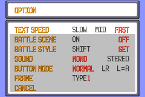
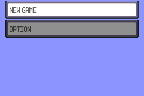
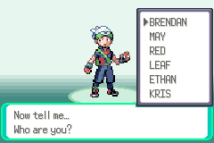
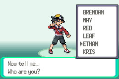
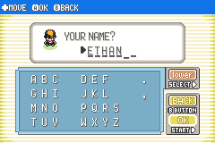
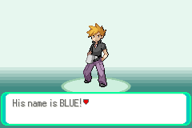

# 00 Start

**Arrival.** Boot the ROM. The intro plays (stars over a dark sky, then the Emerald title with Mewtwo and Rayquaza); START opens the menu. It takes about 800 frames before START answers.

## Story

1. From the title screen pick **OPTION** first: text speed FAST, battle scene OFF, battle style SET. Menu presses are often dropped, so check each one. 
2. Choose **NEW GAME**. OAK's speech starts. 
3. "Now tell me... Who are you?" The menu offers six trainers: BRENDAN, MAY, RED, LEAF, **ETHAN** and KRIS.  
4. The name screen starts empty. Type **ETHAN**; START moves the cursor to OK, then A, then YES to "So your name is ETHAN." 
5. OAK introduces his grandson: "His name is BLUE!". The rival is always **BLUE** in this build, so there is no rival naming screen. 
6. The speech ends in the player's bedroom (PalletTown_PlayersHouse_2F) with ¥3000 and no POKéMON.

## Bugs

None found.
