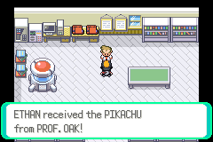
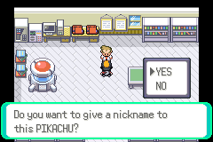
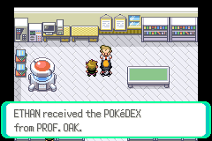
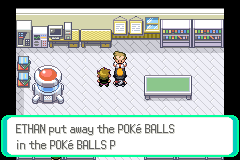

# 01.3 Oak's Lab

**Arrival.** Door (16,13), south-east of town (map PalletTown_ProfessorOaksLab).

## Map notes

- PROF. OAK at (6,3) (talk from (6,4)), his aides ("I study POKéMON as PROF. OAK's AIDE."), computers, books and the POKéDEX machines (not read: OAK stood in the planner's way).

## Story

1. OAK walks the player in. BLUE is waiting: he has already taken SQUIRTLE; RED took CHARMANDER and LEAF BULBASAUR early in the morning. OAK has one more POKéMON, a wild one that chewed on the power cables: **PIKACHU, L5** (THUNDERSHOCK, GROWL; Lonely, 19 HP, stats 12/7/11/10/14).  
2. The nickname prompt (YES/NO): answered NO. 
3. **Second visit, with OAK'S PARCEL** (from the [Viridian Mart](03_viridian_city--mart.md)): "Oh, ETHAN! How is my old POKéMON?", he takes the parcel (a custom POKé BALL) and BLUE arrives. 
   - OAK gives the **POKéDEX** to ETHAN and BLUE ("a high-tech encyclopedia, it records data on POKéMON you've seen or caught"). 
   - He gives **five POKé BALLS** ("you must catch them to obtain complete data"). 
   - He explains catching; BLUE: "I'll borrow a TOWN MAP from my sis!" and leaves. Setting `VAR_MAP_SCENE_VIRIDIAN_CITY_OLD_MAN` to 1 here is what lets the old man in Viridian teach catching.
4. Return visit (after the Boulder Badge): OAK rates the Pokédex: "The amount of progress you've made on your POKéDEX is: 15 POKéMON seen and 7 POKéMON owned. PROF. OAK's rating: ...".
