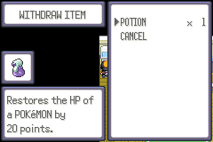
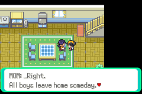

# 01.1 Player's house

**Arrival.** The house at the west of town. 1F (map PalletTown_PlayersHouse_1F) and the bedroom upstairs (2F).

## Map notes

- 1F: the exit warps are (4,8), (5,8) and (3,9); **(5,8) does nothing, use (4,8)** ([bug 1](../playthrough_bugs.md)). The stairs up are an arrow warp at (10,2) (press left); stand on the stair tile and give a *short* right (up) or left (down) press, holding the direction overshoots.
- MOM at (8,4); the TV ("There's a movie on TV. Four boys are walking on railroad tracks. ...I better go, too.").
- 2F (the bedroom): the PC at (1,1) (stand at (1,2) facing up), the NES ("ETHAN played with the NES."), a notice ("If you're confused, ask for HELP! Press the L or R Button!").

## Story

1. In the bedroom, the PC (ITEM STORAGE, WITHDRAW ITEM) holds a **POTION**: taken. 
2. Downstairs, MOM: "...Right. All boys leave home someday. It said so on TV." 
3. On later visits MOM heals the whole party for free ("ETHAN! You should take a quick rest." ... "Oh, good! You and your POKéMON are looking great. Take care now!").
4. Before Route 21 (FLY from Route 20, 6 badges): MOM healed the whole party, BLASTOISE fainted and DRAGONAIR low included (see [Route 21](41_route_21.md)).

## Bugs

- [Bug 1](../playthrough_bugs.md): the exit tile (5,8) does nothing.
