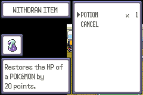
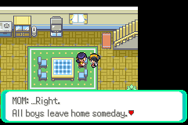
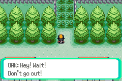
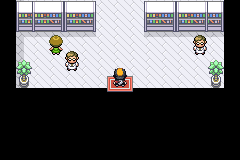
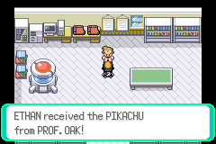
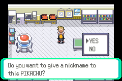
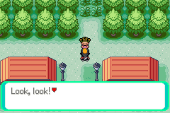

# 01 Pallet Town

**Arrival.** The new game starts in the player's bedroom (PalletTown_PlayersHouse_2F, (6,6)), money ¥3000, no
POKéMON, no badges. See [Start](00_start.md).

## Map notes

- The player's house is at the west, the rival's house east of it, OAK's LAB south-east (door at (16,13)).
- The way out is the one-tile corridor at the top, x 12 (the grass starts at y 1): it leads to
  [Route 1](02_route_1.md). There is no other exit: the sea to the south is closed.
- The player's house, 1F: the exit warps are (4,8), (5,8) and (3,9); **(5,8) does nothing, use (4,8)**
  ([bug 1](../playthrough_bugs.md)). The stairs up are an arrow warp at (10,2) (press left).
- The bedroom's PC is at (1,1): stand at (1,2) facing up.

## Story

1. In the bedroom, use the PC (ITEM STORAGE, WITHDRAW ITEM): there is a **POTION** to take. 
2. Downstairs, MOM at (8,4): "...Right. All boys leave home someday. It said so on TV." 
3. Out of the house, walk to (12,2) and step up: OAK stops the player ("Hey! Wait! Don't go out! It's unsafe!
   Wild POKéMON live in tall grass!") and walks the player to his lab. 
4. In the lab BLUE is waiting: he has already taken SQUIRTLE; RED took CHARMANDER and LEAF BULBASAUR early
   in the morning. OAK has one more POKéMON, a wild one that chewed on the power cables: **PIKACHU, L5**
   (THUNDERSHOCK, GROWL).  
5. The nickname prompt (YES/NO) appears: answered NO. 
6. Leave the lab. **A girl (the sign lady) now stands in the corridor at (12,2) and blocks the way north.** She says
   "Look, look! I copied what it said on one of those TRAINER TIPS signs! ... Press START to open the MENU!"
   
   She only moves after the START menu has been opened **and the map has been re-entered**: open START, close it,
   walk into any building and out again, and the corridor is free. This is the original FireRed tutorial; it is
   not a bug, but a player who talks to her and does nothing else can be stuck.

## Items

- POTION in the bedroom PC (the PC has only this).
- No item balls, no hidden items found.

## Pokémon

- No wild POKéMON here. Gift: **PIKACHU L5**, Lonely, 19 HP, stats 12/7/11/10/14.

## Trainers and shops

- No trainers. No shop (the POKéMON MART opens after the parcel, in Viridian).

## Party after

PIKACHU L5, money ¥3000, 0 badges. POKéDEX not yet (the START menu has POKéMON, BAG, ETHAN, SAVE, OPTION, EXIT).

## Bugs

- [Bug 1](../playthrough_bugs.md): the right half of the house's exit does nothing.
- Interactions tried: the PC, MOM, OAK's scene, BLUE, the sign lady. The sign lady's blocking is intended (see step 6).
- Not tried yet: the fat man and the signs, the other house.

**Save.** None here. See [Route 1](02_route_1.md).
