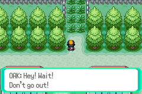
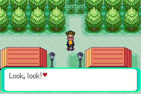

# 01 Pallet Town

**Arrival.** The new game starts in the player's bedroom (PalletTown_PlayersHouse_2F, (6,6)), money ¥3000, no POKéMON, no badges. See [Start](00_start.md). The houses and the lab have their own pages (Places below).

## Map notes

- The player's house is at the west, the rival's house east of it, OAK's LAB south-east (door at (16,13)).
- The way out is the one-tile corridor at the top, x 12 (the grass starts at y 1): it leads to [Route 1](02_route_1.md). There is no other exit: the sea to the south is closed (it opens with SURF, toward Route 21).
- **Signs:** the town sign ("PALLET TOWN Shades of your journey await!"); ETHAN's house; BLUE's house; OAK POKéMON RESEARCH LAB; TRAINER TIPS ("Press START to open the MENU!").
- **Fat man** (wanders near the pond): "Technology is incredible! You can now store and recall items and POKéMON as data via PC. You have a CARD CASE too? How about a friendly duel?" and a **card duel** starts against GUS (SPEAROW as the active card, MEOWTH on his side). Forfeited: "You lost the duel..." and "Ho ho! Small towns have big card players!". No penalty.

## Story

1. Out of the house, walk to (12,2) and step up: OAK stops the player ("Hey! Wait! Don't go out! It's unsafe! Wild POKéMON live in tall grass!") and walks the player to his lab (see [Oak's Lab](01_pallet_town--oaks_lab.md)). 
2. Leaving the lab: **a girl (the sign lady) stands in the corridor at (12,2) and blocks the way north.** "Look, look! I copied what it said on one of those TRAINER TIPS signs! ... Press START to open the MENU!"  She only moves after the START menu has been opened **and the map has been re-entered**: open START, close it, walk into any building and out again. This is the original FireRed tutorial; not a bug, but a player who talks to her and does nothing else can be stuck. Later: "Signs are useful, aren't they?".

## Party after

After the first visit: PIKACHU L5, ¥3000, no POKéDEX. After the parcel: POKéDEX, 5 POKé BALLS.

## Bugs

- [Bug 1](../playthrough_bugs.md): the right half of the player's house exit does nothing (see [Player's house](01_pallet_town--players_house.md)).

**Save.** None here. See [Route 1](02_route_1.md).
