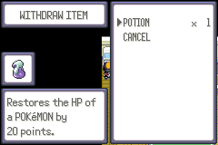
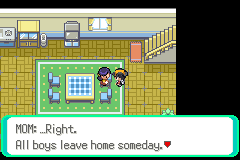
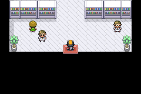
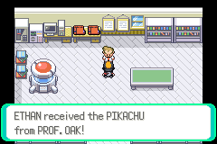
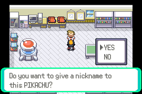
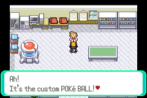
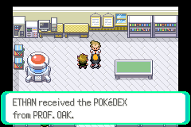
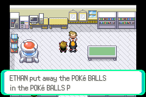

# 01 Pallet Town

**Arrival.** The new game starts in the player's bedroom (PalletTown_PlayersHouse_2F, (6,6)), money ¥3000, no
POKéMON, no badges. See [Start](00_start.md).

## Map notes

- The player's house is at the west, the rival's house east of it, OAK's LAB south-east (door at (16,13)).
- The way out is the one-tile corridor at the top, x 12 (the grass starts at y 1): it leads to
  [Route 1](02_route_1.md). There is no other exit: the sea to the south is closed.
- The player's house, 1F: the exit warps are (4,8), (5,8) and (3,9); **(5,8) does nothing, use (4,8)**
  ([bug 1](../playthrough_bugs.md)). The stairs up are an arrow warp at (10,2) (press left).
- The bedroom's PC is at (1,1): stand at (1,2) facing up.

## Story

1. In the bedroom, use the PC (ITEM STORAGE, WITHDRAW ITEM): there is a **POTION** to take. 
2. Downstairs, MOM at (8,4): "...Right. All boys leave home someday. It said so on TV." 
3. Out of the house, walk to (12,2) and step up: OAK stops the player ("Hey! Wait! Don't go out! It's unsafe!
   Wild POKéMON live in tall grass!") and walks the player to his lab. 
4. In the lab BLUE is waiting: he has already taken SQUIRTLE; RED took CHARMANDER and LEAF BULBASAUR early
   in the morning. OAK has one more POKéMON, a wild one that chewed on the power cables: **PIKACHU, L5**
   (THUNDERSHOCK, GROWL).  
5. The nickname prompt (YES/NO) appears: answered NO. 
6. Leave the lab. **A girl (the sign lady) now stands in the corridor at (12,2) and blocks the way north.** She says
   "Look, look! I copied what it said on one of those TRAINER TIPS signs! ... Press START to open the MENU!"
   
   She only moves after the START menu has been opened **and the map has been re-entered**: open START, close it,
   walk into any building and out again, and the corridor is free. This is the original FireRed tutorial; it is
   not a bug, but a player who talks to her and does nothing else can be stuck.

7. **Second visit, with OAK'S PARCEL** (from the Viridian Mart, see [Viridian City](03_viridian_city.md)): talk to OAK at
   (6,3) from (6,4). He says "Oh, ETHAN! How is my old POKéMON?", takes the parcel (a custom POKé BALL) and BLUE
   arrives. 
   - OAK gives the **POKéDEX** to ETHAN and BLUE ("a high-tech encyclopedia, it records data on POKéMON you've seen or
     caught"; the START menu now has POKéDEX). 
   - He gives **five POKé BALLS** ("you must catch them to obtain complete data"). 
   - He explains catching: throw a ball at a wild POKéMON; it won't always work, a healthy one can escape. He wants the
     two of them to finish his POKéDEX. BLUE: "I'll borrow a TOWN MAP from my sis!" and leaves. Setting
     `VAR_MAP_SCENE_VIRIDIAN_CITY_OLD_MAN` to 1 here is what lets the old man in Viridian teach catching.

## Items

- POTION in the bedroom PC (the PC has only this).
- POKéDEX and 5 POKé BALLS from OAK, after the parcel.
- No item balls, no hidden items found.

## Pokémon

- No wild POKéMON here. Gift: **PIKACHU L5**, Lonely, 19 HP, stats 12/7/11/10/14.

## Trainers and shops

- No trainers. No shop (the POKéMON MART opens after the parcel, in Viridian).

## Party after

After the first visit: PIKACHU L5, ¥3000, no POKéDEX (the START menu: POKéMON, BAG, ETHAN, SAVE, OPTION, EXIT).
After the parcel: POKéDEX, 5 POKé BALLS.

## Everyone and every building

Done after the Boulder Badge (return visit).

- **Signs:** the town sign ("PALLET TOWN Shades of your journey await!"); ETHAN's house; BLUE's house; OAK POKéMON RESEARCH LAB; TRAINER TIPS ("Press START to open the MENU!").
- **Sign lady:** now "Signs are useful, aren't they?".
- **Fat man** (wanders near the pond): "Technology is incredible! You can now store and recall items and POKéMON as data via PC. You have a CARD CASE too? How about a friendly duel?" and a **card duel** starts against GUS (SPEAROW as the active card, MEOWTH on his side; deck 15, hand 5; the menu offers Play (cards in hand), Look at the cards and Forfeit). We forfeited: "You lost the duel..." and "Ho ho! Small towns have big card players!". No penalty.
- **ETHAN's house:** MOM heals the whole party for free ("ETHAN! You should take a quick rest." ... "Oh, good! You and your POKéMON are looking great. Take care now!"); the TV ("There's a movie on TV. Four boys are walking on railroad tracks. ...I better go, too."). **Bedroom:** the NES ("ETHAN played with the NES.") and a notice ("If you're confused, ask for HELP! Press the L or R Button!"). The stairs: stand on the stair tile and give a *short* right (up) or left (down) press; holding the direction overshoots.
- **BLUE's house:** his sister **DAISY** gives the **TOWN MAP**: "Grandpa asked you to run an errand? Gee, that's lazy of him. Here, this will help you. ETHAN received a TOWN MAP from DAISY." and "You can use the TOWN MAP to find out where you are, or check the names of places." (KEY ITEMS). A bookshelf ("The shelves are crammed full of books on POKéMON.").
- **OAK's LAB:** the aides ("I study POKéMON as PROF. OAK's AIDE."); **OAK** rates the Pokédex: "Good to see you! How is your POKéDEX coming along? Here, let me take a look. The amount of progress you've made on your POKéDEX is: 15 POKéMON seen and 7 POKéMON owned. PROF. OAK's rating: ..."

## Bugs

- [Bug 1](../playthrough_bugs.md): the right half of the house's exit does nothing.
- Interactions tried: the PC, MOM, OAK's scene, BLUE, the sign lady. The sign lady's blocking is intended (see step 6).
- Everything reachable was tried on the return visit (see "Everyone and every building"); the lab's computers, signs and Pokédex machines were out of the path planner's reach (Oak stood in the way) and were not read.

**Save.** None here. See [Route 1](02_route_1.md).
