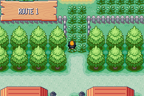
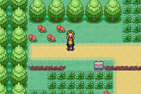
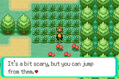

# 02 Route 1

**Arrival.** From [Pallet Town](01_pallet_town.md): step up from (12,1) onto Route 1 (map 36.19), arriving at (12,39).
Pikachu L5, no badges. 

## Map notes

- 24x40 tiles. A long path north (the exit to [Viridian City](03_viridian_city.md) is at the top, x about 10-14), with
  grass on both sides, several one-way ledges (they face south) and two NPCs. Viridian's side is offset by 12 tiles.
- Ledges are jumped by walking into them: you can only go **down** them. Going north follows the gaps.
- A save at the entrance, before any battle: `saves/ethan_route1.sav`.

## NPCs and what they taught

- **Mart clerk at (6,28)** (stand at (6,29) facing up): "I work at a POKéMON MART... Please visit us in VIRIDIAN CITY...
  I'll give you a sample" and gives **1 POTION** (once). 
  *Learned: the Mart is in Viridian City.*
- **Boy at (19,16)** (stand at (19,17) facing up): "See those ledges along the road? It's a bit scary, but you can jump
  from them. You can get back to PALLET TOWN quicker that way." 
  *Learned: ledges are one-way jumps, southbound.*

## Items

- 1 POTION from the clerk.

## Pokémon

Grass on both sides of the path (the first patch is right at the entrance). Fought on the way, with `gotf`:
the species were not recorded (the run was automatic); five battles in all over three crossings, Pikachu L5 to L6,
which taught it TAIL WHIP. Record each species from the next crossing.

## Trainers and shops

No trainers. No shop here (the clerk only gives a sample).

## Party after

PIKACHU L6 (THUNDERSHOCK, GROWL, TAIL WHIP), HP 11/21 after the crossings. Money ¥3000.

## Bugs

None found. Interactions tried: the clerk, the boy.

**Save.** `saves/ethan_route1.sav` (at the entrance).
