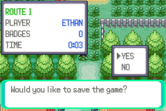

# 02 Route 1

**Arrival.** From [Pallet Town](01_pallet_town.md): step up from (12,1) onto Route 1 (map 36.19), arriving at (12,39).
Pikachu L5, no badges. 

## Map notes

- A long path north to Viridian City, with grass on both sides at the start. Ledges face south, so going north the
  way past the first ledge is the west gap (from the guide; to be checked here).

## Story

1. A save was made at the entrance, before any battle: `saves/ethan_route1.sav` (START, SAVE, YES). 

(The route itself is not played yet.)

## Items, Pokémon, trainers, shops

To be filled in as the route is walked.

## Bugs

None found yet.

**Save.** `saves/ethan_route1.sav`: Route 1 entrance, Pikachu L5, ¥3000.
