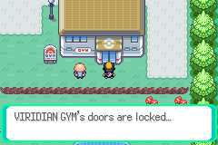

# 03.5 Viridian Gym (Giovanni)

**Arrival.** Door (36,10). Locked until the other seven badges are won; opened on the return to Kanto after the Volcano Badge.

## Map notes

- Before the seven badges: stepping at its door gives "VIRIDIAN GYM's doors are locked..." and pushes the player back. 
- A maze of **spinner tiles** (arrows that slide the player until a stopper). The position readout of the tools falls out of step after a slide (the real tile is the player object's one); the static planner (`pathf`, `goto`) models spinners, the real-game walker (`rbfs`) gives up in the maze. From the top of the Gym there is no way to Warren and Samuel: walk back to the entrance and take the planner's route from there.
- The Gym guide (16,20): "Even I don't know the VIRIDIAN LEADER's identity. But one thing's certain. This will be the toughest of all..." After the badge: "Blow me away! GIOVANNI was the GYM LEADER of VIRIDIAN?"
- GIOVANNI (2,2): RHYHORN, DUGTRIO, NIDOQUEEN, NIDOKING, RHYHORN (Ground types).
- **Hidden MACHO BRACE at (2,2), under GIOVANNI's tile**: it is reachable once he has left; stand on the tile and press A (an underfoot hidden item, see bug 8 in `docs/playthrough_bugs.md`).

## Story

1. **Back to Kanto** from Two Island: FLY from the bag, then **R** on the Fly map to switch from the Sevii page to Kanto, onto Viridian City.
2. **Gym trainers**, the lowest-level member in front (autolead after each fight): black belt TAKASHI, cooltrainer YUJI, black belt ATSUSHI, tamers JASON and COLE, black belt KIYO, cooltrainer WARREN (VENUSAUR's RAZOR LEAF did most of it; DRAGONAIR was poisoned, cured with a FULL HEAL) and cooltrainer SAMUEL (GENGAR's PSYCHIC). Super Potions between them.
3. **GIOVANNI**, BLASTOISE in front: five SURFs, no switch. "The EARTHBADGE makes POKéMON of any level obey without question." **EARTH BADGE** (8th), **TM26 EARTHQUAKE** ("I made it when I ran the GYM here"), ¥5 000. "Having lost in this fashion, I can't face my followers... As of today, TEAM ROCKET is finished forever!"
4. He then offers a **card duel** ("Cards... A game of strategy."). It was accepted by mistake and forfeited from the last line of the duel menu (`Forfeit`; nothing is lost). Then GIOVANNI leaves the Gym.
5. The **MACHO BRACE** under his tile. Healed at the Viridian Center and saved (`saves/ethan_earth_badge.sav`). All eight Kanto badges: next is the Pokémon League by Route 22 and Route 23.
