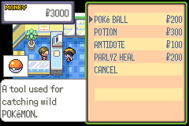
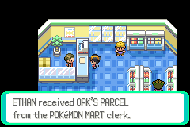

# 03.2 Viridian Mart

**Arrival.** Door (36,19).

## Map notes

- **Stock:** POKé BALL ¥200, POTION ¥300, ANTIDOTE ¥100, PARLYZ HEAL ¥200. 
- A customer ("You never know when your POKéMON will need quick healing. I've got to buy some POTIONS.") and a woman ("This shop does good business in ANTIDOTES, I've heard.").

## Story

1. The clerk calls the player the moment they step in ("Hey! You came from PALLET TOWN?... You know PROF. OAK, right? His order came in. Can I get you to take it to him?") and gives **OAK'S PARCEL** (KEY ITEMS). The shop opens afterwards. 
2. The parcel went to OAK ([Oak's Lab](01_pallet_town--oaks_lab.md)): POKéDEX and 5 POKé BALLS.
