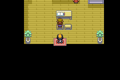

# 03.4 Viridian school

**Arrival.** Door (25,18).

## Map notes

- The teacher ("Be sure to read what's on the blackboard carefully!"), a student ("Whew! I'm trying to memorize all my notes."), a bookshelf, and the **blackboard**: the five status conditions SLP (AWAKENING), PSN (ANTIDOTE), PAR (PARLYZ HEAL), BRN (BURN HEAL) and FRZ (ICE HEAL), each lasting after battles. 
