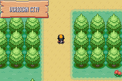
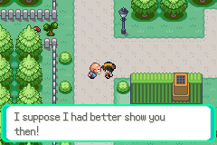
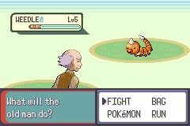
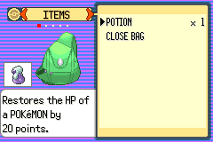
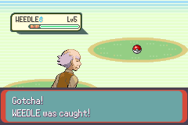
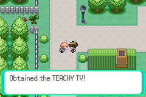

# 03 Viridian City

**Arrival.** North end of [Route 1](02_route_1.md): arrive at (24,38) on Viridian City's south edge (map 36.1). The buildings and the Gym have their own pages (Places below). 

## Map notes

- POKéMON CENTER door (26,26); MART door (36,19); SCHOOL (25,18); HOUSE (25,11); GYM (36,10), locked at first; pond and the south shore at y 38.
- The **old man** stands at (21,6) next to the way north (a Cut tree at (18,5) and an item ball with a POTION at (17,5) on the west side); a woman at (20,12), a second old man at (34,11) by the Gym.
- Before the parcel is delivered a trigger at (22,11) stops the player from going north (the old man blocks the road: "that's my coffee").
- **Streets:** a woman ("I go shopping in PEWTER CITY occasionally. I have to take the winding trail in VIRIDIAN FOREST when I go."); an old man by the Gym ("This POKéMON GYM is always closed. I wonder who the LEADER is?"); a youngster (CATERPIE has no poison, but WEEDLE does...); a boy near the pond (a card player: "Come back when you have a deck!").
- **Signs:** "VIRIDIAN CITY The Eternally Green Paradise"; two TRAINER TIPS (catching, and PP / healing at a Center); the Gym sign.
- **Not reachable yet:** the POTION in the fenced grove (17,5) and the Dream Eater tutor at (8,26), both behind Cut trees.

## Story

1. After the [Mart](03_viridian_city--mart.md) gave OAK'S PARCEL and it was delivered in [Pallet Town](01_pallet_town--oaks_lab.md), back in Viridian: walk up to (22,9) and step to (22,8): the old man's trigger starts the **catching tutorial**. 
   - "Hm? What is that red box you have?... You don't know how to catch a POKéMON? I suppose I had better show you then!"
   - A demo battle against a **WEEDLE L5**: he opens his bag (POTION x1, POKé BALL x1) and throws the ball: "Gotcha! WEEDLE was caught!"   
   - He gives the **TEACHY TV** (KEY ITEMS): "If there's something you don't understand, watch that."  Afterwards: "At first, focus on weakening the POKéMON before trying to catch it."
2. Saved here: `saves/ethan_viridian_tutorial.sav`.

## Party after

After the tutorial: PIKACHU L6, 5 POKé BALLS, ¥3000, POKéDEX with 1 entry. At the end of the full pass (second visit): MANKEY L13, PIKACHU L10, PIDGEY L5, CATERPIE L4; ¥394; 0 badges; POKéDEX 4.

## Bugs

None found.

**Save.** `saves/ethan_viridian_tutorial.sav` (after the tutorial).
