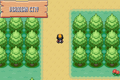
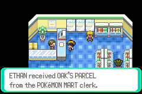
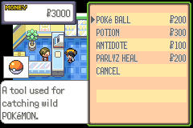
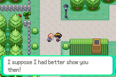
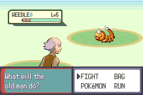
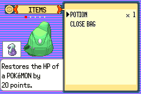
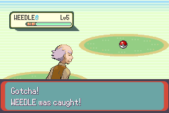
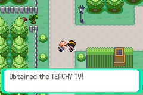

# 03 Viridian City

**Arrival.** North end of [Route 1](02_route_1.md): arrive at (24,38) on Viridian City's south edge (map 36.1).

## Map notes (coordinates are tiles)

- POKéMON CENTER door (26,26); MART door (36,19); SCHOOL (25,18); HOUSE (25,11); GYM (36,10), locked at first
  (a trigger at (36,11) turns you back); pond and the south shore at y 38.
- The **old man** stands at (21,6) next to the way north (a Cut tree at (18,5) and an item ball with a POTION at (17,5)
  are on the west side); a woman at (20,12), a second old man at (34,11) by the Gym.
- Before the parcel is delivered a trigger at (22,11) stops the player from going north (the old man blocks the
  road: "that's my coffee").

## Story

1. Enter the **MART** (door (36,19)): the clerk calls the player the moment they step in ("Hey! You came from PALLET
   TOWN?... You know PROF. OAK, right? His order came in. Can I get you to take it to him?") and gives **OAK'S PARCEL**
   (KEY ITEMS pocket). The shop opens afterwards. 
2. The Mart: POKé BALL ¥200, POTION ¥300, ANTIDOTE ¥100, PARLYZ HEAL ¥200. 
3. Walk back through Route 1 to Pallet Town and give the parcel to OAK ([Pallet Town](01_pallet_town.md), step 7):
   POKéDEX and 5 POKé BALLS.
4. Back in Viridian, walk up to (22,9) and step to (22,8): the old man's trigger starts the **catching tutorial**.
   
   - He has had his coffee: "Hm? What is that red box you have?... Ah, so you're working on your POKéDEX... Whenever you
     catch a POKéMON, the POKéDEX automatically updates its data... You don't know how to catch a POKéMON? I suppose I
     had better show you then!"
   - A demo battle against a **WEEDLE L5**: he opens his bag (POTION x1, POKé BALL x1) and throws the ball: "Gotcha!
     WEEDLE was caught!"   
   - "There! Now tell me, that was educational, was it not? And here, take this, too." He gives the **TEACHY TV** (KEY
     ITEMS): "If there's something you don't understand, watch that. It will teach you about the basics of being a
     POKéMON TRAINER." 
   - Talking to him afterwards repeats a tip: "At first, focus on weakening the POKéMON before trying to catch it."
5. Saved here: `saves/ethan_viridian_tutorial.sav`.

## Items

- OAK'S PARCEL (delivered, gone). TEACHY TV. A POTION item ball at (17,5) (not taken yet).

## Pokémon / trainers

None yet. (The Gym is locked, the school and the Cut tree are not visited.)

## Shops

The MART as above.

## Party after

PIKACHU L6 (HP 11/21), 5 POKé BALLS, 2 POTIONS (one from the PC, one from the clerk), POKéDEX with 1 entry, ¥3000,
0 badges.

## Bugs

None found. Interactions tried: the Mart clerk and shop, the old man, the demo. Not tried: the woman, the second old
man, the Center, the school.

**Save.** `saves/ethan_viridian_tutorial.sav`.
