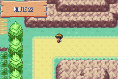
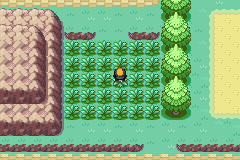
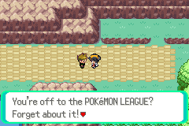
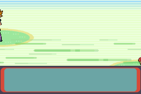
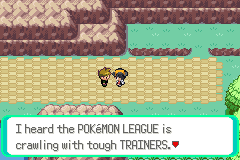

# 04 Route 22

**Arrival.** From [Viridian City](03_viridian_city.md): walk to its west edge at (1,17) and step left; Route 22 (map 36.41) starts at (46,7), its east end. 

## Map notes

- A long east-west route to the Pokémon League gate. The upper path is sand, with **Blue's trigger at x=33 (y 4-6)**.
- Two grass patches: x 34-39, y 9-13 (east of the trigger, reached from the east end) and x 15-21, y 9-13 (west of it).

## Story

1. Walk into the east grass at (37,11) and fight wild POKéMON with `train`. The wild levels are only 2-5 (Rattata, Mankey, Spearow by day; no Spearow at night).
2. A wild **Mankey L4** showed up. One THUNDERSHOCK left it at 1 HP and, thanks to Pikachu's Static, paralyzed. One POKé BALL caught it, first throw. (The battle screenshots of this catch were taken blank and are lost; here is the patch.) 
3. Training here was slow: about fifteen battles took Pikachu from L6 to L6 and Mankey from L4 to L4. With Mankey in front and Pikachu switched in (the manual override), each fight wore Pikachu down. We went back to Viridian's Center twice and moved to Route 2.

4. **Blue**, the rival, on the sand path (second visit, after Pewter and the forest; PIKACHU in front): walking onto x=33 at (33,5) stops the player: "Hey! ETHAN! You're off to the POKéMON LEAGUE? Forget about it! You probably don't have any BADGES, do you? The guard won't let you through without them. By the way, did your POKéMON get any stronger?" 
   - His team (the game's data): **PIDGEY L9** (Tackle, Sand-Attack) and **SQUIRTLE L9** (Tackle, Tail Whip). Both fall to THUNDERSHOCK: four turns, ¥144, PIKACHU L10. 
   - After the fight: "I heard the POKéMON LEAGUE is crawling with tough TRAINERS. I have to figure out how to get past them. You should quit dawdling and get a move on!" 

## Party after

PIKACHU L10, MANKEY L13 after the second visit (the first visit left PIKACHU L6, MANKEY L4). Money ¥394 after the fight.

## Bugs

None found. Not done: the League gate (needs the eight badges).
