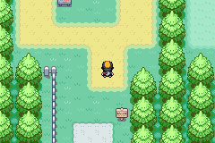
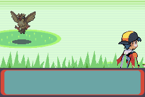
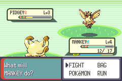
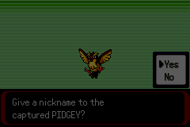

# 05 Route 2

**Arrival.** From [Viridian City](03_viridian_city.md): leave by its north edge at (22,1); Route 2 (map 36.20) starts at (10,78), its south end. 

## Map notes

- A tall route (80 rows). South part: the way north is the sand column on the west, x 3-5 (y 55-72), because a ledge across the road at y 69-70 only goes down. The Viridian Forest **south gate** is at (5-6,51); the grass between it and the ledge is x 6-12, y 55-60.
- The north part, past the forest, leads to Pewter City; its Viridian Forest **north gate** is at (5-6,13).
- Cut trees at (16,62), (15,69), (11,13), (18,26). Item balls: ETHER (17,54) and PARALYZ HEAL (17,64), on the east side.
- (Tool note: Route 2 has an object, a clone of Viridian's border Cut tree, placed at y=85, outside the map on purpose. The path planner crashed on it; fixed.)

## Story

1. Walk to (4,62), then into the grass at (8,58) and fight with `train` (Pidgey, Rattata by day; Caterpie, Weedle sometimes; Hoothoot and Spinarak at night).
2. A wild **Pidgey L3**: Mankey's SCRATCH took it to 4 HP and one ball held.   
3. Levelling here was slow and cost three trips to Viridian's Center (the road back is about 35 tiles). Pikachu reached L7 and Mankey L6; two POTIONS from the bag kept them going. (Pikachu fell to 2 HP when switched in on every fight, so Mankey was put in front instead: the first time it fainted at 0/20.)

## Levelling for the Brock fight (the north grass, south of Pewter)

The rule "at most 2 levels between the highest and lowest POKéMON" needed the low ones raised before Brock. Route 2's north grass (x 1-9, y 0-8, just south of Pewter, wilds L2-5) was used with the helper `cycle`: the lowest POKéMON leads, PIKACHU is switched in on turn 1 as the finisher (MANKEY, the highest, is left out), and when someone is under 30% HP the party walks to Pewter's Center, heals and comes back. One cycle gave about 100 experience.
- 11 cycles took CATERPIE from L5 to **METAPOD, then BUTTERFREE** (L12-13) and PIKACHU from L10 to L14. PIKACHU learned **QUICK ATTACK** at L11 (forgetting GROWL); the move-learning prompt stopped the auto-battle each time and was answered by hand. BUTTERFREE learned **POISONPOWDER** at L13 (forgetting HARDEN).
- A second batch of cycles led with PIDGEY (L5) and BUTTERFREE as the finisher: PIDGEY reached **L10** and learned **GUST** when the grind was stopped on request.
- Result of those batches: PIKACHU L14, MANKEY L13, BUTTERFREE L13, PIDGEY L10.
- **Letting the lead fight alone** (the switch rule as the safety net, GUST as the move) gave about 700 experience per cycle, seven times the shared method. A six-cycle batch left running unattended **overshot**: PIDGEY went from L10 to L13, L15, L16, L17 and finally evolved into **PIDGEOTTO L18**, five levels above the rest. The lesson, now in the guide: run these batches in counted steps and stop at the target level.
- To bring the others up, a rebalancing batch began: PIKACHU reached L15 (it was offered DOUBLE TEAM and declined), and MANKEY and BUTTERFREE were still L13 when the grind was stopped on request.
- Team at the save: PIDGEOTTO L18, PIKACHU L15, MANKEY L13, BUTTERFREE L13 (a spread of 5).

## Later visit: fetching HM05 FLASH (north end, after Route 10)

1. **Why:** the Rock Tunnel is dark and the rocker of Route 2's east building says it himself: "Once a POKéMON learns FLASH, you can get through ROCK TUNNEL." HM05 is the **Aide's gift here (10 or more POKéMON seen)**. The Rock Tunnel leg was paused at its first floor and the party walked here from Route 10: Route 9 (the Cut tree at (2,8) had grown back), Cerulean through the robbed house, Route 5, the Underground Path, Route 6, Vermilion, Route 11 and **Diglett's Cave** to its north door, which opens on Route 2 at (17,11).
2. **The Cut tree at (18,26)** blocks the road south of the cave door: "CHARMELEON used CUT!" (the tree regrows whenever the map is reloaded, a building visit included, so it had to be cut again on the way back).
3. **The east building** is a gatehouse across the road: doors (18,41) and (19,41) on its north side, (18,46) and (19,46) on the south side (the door you enter by decides which side you leave on). Inside, the **Aide** at (4,6): "ETHAN put away the HM05 in the TMs & HMs POCKET." (no yes/no beyond the Aide's first question; the Pokédex count was far above 10).
4. **The rocker** at (10,3) says the FLASH hint and then, with no question asked, starts a **card duel** (the ROM's added card game: `cardduel CARD_OPPONENT_ROUTE2_ROCKER`). The duel screen opened with decks 14 and 15, a hand of "Play PROF. OAK'S RESEARCH" cards and an action menu; my A presses landed inside it. **Forfeit** is the last action of the menu (the list scrolls: five presses of DOWN), then "Forfeit the duel? A: yes B: no": "You lost the duel..." and the overworld returns, no penalty. A full duel was not played: left for a dedicated test (it is listed in the bugs page).
5. **Teaching FLASH:** START, BAG, the TMs & HMs pocket, and the list's last entries are HM01 CUT and **HM05 FLASH**, then CLOSE BAG. USE: "Booted up an HM. It contained FLASH." "Teach FLASH to a POKéMON?" The party screen says ABLE for **PIKACHU, ALAKAZAM and IVYSAUR** and NOT ABLE for CHARMELEON, PRIMEAPE and WARTORTLE. PIKACHU: "However, PIKACHU already knows four moves." "Should a move be deleted and replaced with FLASH?" YES, and TAIL WHIP (the weakest) was picked: "1, 2, and... ... ... Poof!" PIKACHU now has THUNDERBOLT, QUICK ATTACK, FLASH and THUNDER WAVE.
6. **The way back:** the cave's south door (Route 11, Vermilion), the **Vermilion Center** (heal and save `saves/ethan_flash.sav`), Route 6, the Underground Path, Cerulean's robbed house, Route 9 and the Rock Tunnel, where FLASH was used from the party menu (PIKACHU, FLASH in the field menu) for the rest of the tunnel. On the walk CHARMELEON reached L34 and learned **FLAMETHROWER** (replacing SCARY FACE) and ALAKAZAM reached L30 (FUTURE SIGHT declined).

## Party after

PIKACHU L7, MANKEY L6, PIDGEY L3.

## Bugs

None found.
