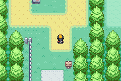
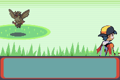
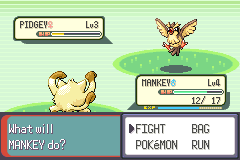
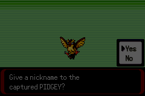

# 05 Route 2

**Arrival.** From [Viridian City](03_viridian_city.md): leave by its north edge at (22,1); Route 2 (map 36.20) starts at (10,78), its south end. 

## Map notes

- A tall route (80 rows). South part: the way north is the sand column on the west, x 3-5 (y 55-72), because a ledge across the road at y 69-70 only goes down. The Viridian Forest **south gate** is at (5-6,51); the grass between it and the ledge is x 6-12, y 55-60.
- The north part, past the forest, leads to Pewter City; its Viridian Forest **north gate** is at (5-6,13).
- Cut trees at (16,62), (15,69), (11,13), (18,26). Item balls: ETHER (17,54) and PARALYZ HEAL (17,64), on the east side.
- (Tool note: Route 2 has an object, a clone of Viridian's border Cut tree, placed at y=85, outside the map on purpose. The path planner crashed on it; fixed.)

## Story

1. Walk to (4,62), then into the grass at (8,58) and fight with `train` (Pidgey, Rattata by day; Caterpie, Weedle sometimes; Hoothoot and Spinarak at night).
2. A wild **Pidgey L3**: Mankey's SCRATCH took it to 4 HP and one ball held.   
3. Levelling here was slow and cost three trips to Viridian's Center (the road back is about 35 tiles). Pikachu reached L7 and Mankey L6; two POTIONS from the bag kept them going. (Pikachu fell to 2 HP when switched in on every fight, so Mankey was put in front instead: the first time it fainted at 0/20.)

## Levelling for the Brock fight (the north grass, south of Pewter)

The rule "at most 2 levels between the highest and lowest POKéMON" needed the low ones raised before Brock. Route 2's north grass (x 1-9, y 0-8, just south of Pewter, wilds L2-5) was used with the helper `cycle`: the lowest POKéMON leads, PIKACHU is switched in on turn 1 as the finisher (MANKEY, the highest, is left out), and when someone is under 30% HP the party walks to Pewter's Center, heals and comes back. One cycle gave about 100 experience.
- 11 cycles took CATERPIE from L5 to **METAPOD, then BUTTERFREE** (L12-13) and PIKACHU from L10 to L14. PIKACHU learned **QUICK ATTACK** at L11 (forgetting GROWL); the move-learning prompt stopped the auto-battle each time and was answered by hand. BUTTERFREE learned **POISONPOWDER** at L13 (forgetting HARDEN).
- A second batch of cycles led with PIDGEY (L5) and BUTTERFREE as the finisher: PIDGEY reached **L10** and learned **GUST** when the grind was stopped on request.
- Result: PIKACHU L14, MANKEY L13, BUTTERFREE L13, PIDGEY L10: still 4 levels apart, so the balance rule is not yet met.

## Party after

PIKACHU L7, MANKEY L6, PIDGEY L3.

## Bugs

None found.
