# 06 Viridian Forest

**Arrival.** From [Route 2](05_route_2.md): the south gate house (door at (5-6,51), inside at (7,10)); a woman there says "Are you going to VIRIDIAN FOREST? It's a natural maze in there. Be careful you don't get lost." The forest (map 34.0) begins at (29,62). 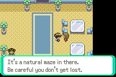

## Map notes

- A big maze (63x63): the route from the south entrance (28-30,62) goes up the east side, across the top, and down the west side to the north gate at (4-6,9). Wild grass fills most of it.
- Five **Bug Catchers**: Rick (47,45), Doug (47,29), Anthony (43,6), Charlie (16,5), Sammy (7,22).
- Items: POTION (49,60), hidden ANTIDOTE (28,57), ANTIDOTE (40,21), POTION (21,34), POKé BALL (5,41), hidden POTION (3,22).
- Behind three Cut trees at (51,5-7) is the Bulbasaur clearing (62,7), where two angry Beedrill guard a lost BULBASAUR: it needs Cut and comes later.

## Story

1. At (29,58) a youngster: "I came here with friends to catch us some BUG POKéMON! They're all itching to get into some POKéMON battles!" 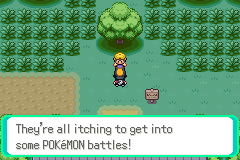 At (45,58) a boy: "I was throwing POKé BALLS to catch POKéMON, and I ran out. That's why you can never have too many POKé BALLS." 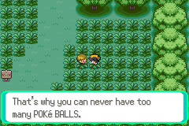
2. Pick up the hidden ANTIDOTE at (28,57), the POTION at (49,60), then walk the maze. 
3. **Rick** (Weedle L6, Caterpie L6): ¥96. **Doug** (Weedle L7, Kakuna L7, Weedle L7): ¥112; the fight took 14 turns. 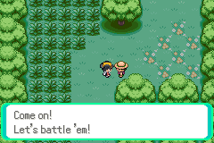 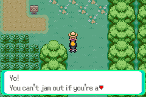
4. In the grass a wild **Caterpie L4**: one THUNDERSHOCK left it at 5 HP. `catch` threw nothing, because after healing with a Potion the bag reopens on the ITEMS pocket: open the POKé BALLS pocket first, then the first ball held. 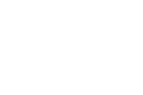 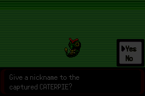
5. A wild **PIKACHU L3 holding an ORAN BERRY** appeared (as in FireRed, a rare forest Pikachu) and knocked CATERPIE out; PIKACHU (L7) caught it after one THUNDERSHOCK left it at 8 HP and paralyzed. 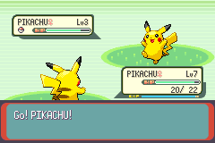 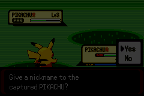
6. **Anthony** (Caterpie L7, Caterpie L8): ¥128; Pikachu reached L8 and learned THUNDER WAVE. Then the items: the ANTIDOTE at (40,21), the POTION at (21,34) and the POKé BALL at (5,41). 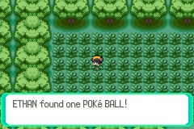 Wild battles on those walks wore the team down with no Center near, and **both Pikachu and Mankey fainted**: the game **blacked out** and put the team, healed, back at Viridian's Center, with half the money gone (¥1436 → ¥718). Exp and the beaten trainers were kept. 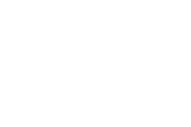
7. Back in the forest by the south gate: **Sammy** (Weedle L9): ¥144, MANKEY L10, and **Charlie** (Metapod L7, Caterpie L7, Metapod L7): ¥112, MANKEY L11. The hidden POTION at (3,22) did not turn up: the bag has one POTION fewer than the items found. 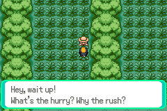 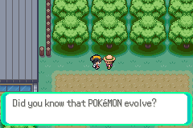
8. The north gate house has three more talkers: a youngster ("You need to be persistent and look everywhere to get different kinds. Many POKéMON live only in forests and caves."), an old man ("Have you noticed the skinny trees on the roadside? They can be cut down by a special POKéMON move, I hear.") and a woman ("When a POKéMON is evolving, you can stop the process. It's a technique for raising POKéMON the way they are."). 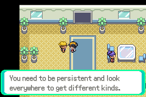 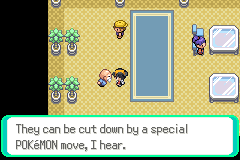 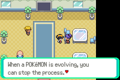

## Party after

MANKEY L11 (Low Kick learned at L9), PIKACHU L9 (Thunder Wave), PIDGEY L5, CATERPIE L4, PIKACHU L4. Money ¥974.

## Bugs

None found. Interactions tried: both gate houses (the south gate's second woman repeated the first one's line), all five trainers, the youngster, the boy, five of the six items (the hidden POTION at (3,22) was not found). The Bulbasaur clearing was not visited (needs Cut).
