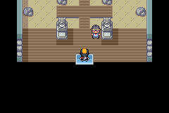
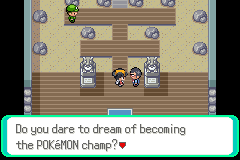
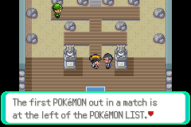
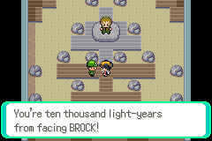
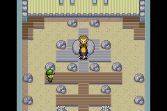
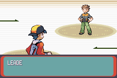
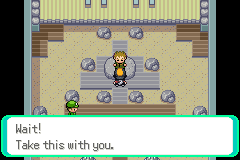
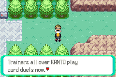
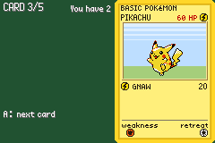

# 07.6 Pewter Gym (Brock)

**Arrival.** From [Pewter City](07_pewter_city.md): the door at (15,16); inside at (6,14) (map 39.2). 

## Map notes

- A rock-and-ramp room: Camper Liam at (3,8), a gym guide at (7,12) next to the entrance, BROCK on his platform at (6,5). The way to him runs up the middle column x=6.
- Leaving: stand on the mat at (6,14) and press down. Walking down onto it is not enough.

## Story

1. The gym guy (7,12): "Do you dare to dream of becoming the POKéMON champ? I'm no TRAINER, but I can advise you on how to win. ... The first POKéMON out in a match is at the left of the POKéMON LIST. By changing the order of POKéMON, you may gain an advantage. Try different orders to suit your opponent's party." The last box closes only after a few more presses.  
2. **Camper Liam** (Geodude L10, Sandshrew L11): MANKEY in front with LOW KICK did most of the work; ¥176; MANKEY L12. 
3. Healed at the Center, came back, and stopped at (6,6), one tile below BROCK, **without talking to him**. The run was saved there: `saves/ethan_brock_door.sav`. 

4. **Brock** (second visit, MANKEY in front with LOW KICK, the switch rule as a safety net): "Fine, then! Show me your best!" His **GEODUDE L12** (31 HP) and **ONIX L14** both fell in four turns in all (LOW KICK, a heavy-target move, is super effective on Rock and Ground), and the fight paid **¥1400** (his last POKéMON's level times 100) (¥294 → ¥1694); MANKEY reached **L14**.  Afterwards: "Wait! Take this with you." **TM39 (ROCK TOMB)** ("A TM, Technical Machine, contains a technique for POKéMON. Using a TM teaches the move it contains to a POKéMON. A TM is good for only one use. So, when you use one, pick the POKéMON carefully. Anyways... TM39 contains ROCK TOMB. It hurls boulders at the foe and lowers its SPEED."), then his advice ("There are all kinds of TRAINERS in this huge world of ours. You appear to be very gifted as a POKéMON TRAINER. So let me make a suggestion. Go to the GYM in CERULEAN and test your abilities.") and, when spoken to again: "I play POKéMON cards, too. Come back when you have a deck!"  The BOULDER BADGE counts: the save screen shows 1 badge.
5. **The Card Case.** With BROCK beaten the Gym guide no longer stops the player, and the **aide** on the east road (46,21-23) walks up: "Oh, ETHAN! I'm glad I caught up to you. I'm PROF. OAK's AIDE. The PROF. has a new passion: POKéMON cards! Trainers all over KANTO play card duels now. He asked me to deliver this, so here you go." **CARD CASE** (KEY ITEMS), with a deck of 20 cards ("Every POKéMON you catch also gives you a copy of its card! Packs can have a second copy of the POKéMON you've caught. And here's your first card pack!"). The first pack: BELLSPROUT, MAGIKARP, PIKACHU (a second copy), TANGELA, SEADRA. "Use the CARD CASE in your BAG to build your decks. Talk to people in every town. Many of them play cards! And every day, the first POKé MART clerk you visit has a free pack! Well, I must be going back to the LAB. Bye-bye!"  
6. **The daily free pack** works: at Pewter's Mart the clerk opened a second pack (one card a "MEGA ex": "knocked out, it gives 3 trophies").

## Party after

PIDGEOTTO L18, PIKACHU L15, MANKEY L14, BUTTERFREE L13 (a spread of 5: the grind overshot PIDGEOTTO; balancing continues with the next trainers). ¥1694, 1 badge, CARD CASE, TM39. Pokédex 7 caught.

## Bugs

None found. **Save.** `saves/ethan_pallet_boulder.sav` (Pallet Town, after the badge and the Card Case).
