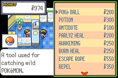

# 07.2 Pewter Mart

**Arrival.** Door (28,18).

## Map notes

- **Stock:** POKé BALL ¥200, POTION ¥300, ANTIDOTE ¥100, PARLYZ HEAL ¥200, AWAKENING ¥250, BURN HEAL ¥250, ESCAPE ROPE ¥550, REPEL ¥350. 
- A youngster ("It's totally weak and it cost ¥500!", about a fish POKéMON) and a boy ("The shelves brim with all sorts of POKéMON merchandise.").

## Story

1. Bought three POTIONS (¥900).
