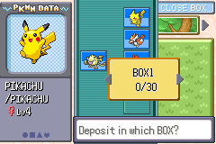

# 07.1 Pewter Pokémon Center

**Arrival.** Door (17,25).

## Map notes

- **1F:** the nurse; a JIGGLYPUFF ("Puu pupuu!"); a gentleman on the phone ("TEAM ROCKET is at MT. MOON? Huh? I'm on the phone! Scram!"); a youngster by the Jigglypuff (a card player for later); two boys trading ("I had two PIKACHU..." / "I'm trading my CLEFAIRY for one."); the **Mystery Event Club woman**, who asks for the player's **profile** and opens the Easy Chat editor (pressing A through it types words: "GEODUDE A POKéMON FRIEND" got typed; cancel with B, then YES to "Quit editing?"). The PC is at (11,2).
- **2F** (stairs at (1,6), walk onto them from the east pressing left): a **link room**: the attendant TEALA explains the WIRELESS CLUB (UNION ROOM, DIRECT CORNER); her explanation loops while "Is there something you needed to ask me about linking?" is answered YES (answer NO). The MYSTERY GIFT man and the other attendants lead to link features that can't be used here.

## Story

1. Healed (the nurse restores HP and PP). Saved here.
2. At the PC (stand at (11,3) facing up): SOMEONE'S PC, DEPOSIT POKéMON, STORE: the spare PIKACHU L4 went to BOX 1. 
