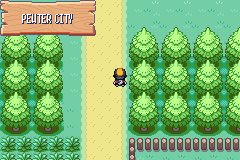

# 07 Pewter City

**Arrival.** From [Route 2](05_route_2.md): the north end of the route (11,0), arriving at (23,38) on Pewter's south side (map 36.2). The buildings, the Museum and the Gym have their own pages (Places below). 

## Map notes

- Pokémon Center door (17,25); Mart (28,18); Gym (15,16); two Museum doors (17,6) and (25,4); houses at (33,11) and (9,30).
- The Gym sits in a fenced loop: go up the east side past the Mart, then west along y 17-18.
- **Streets:** a fat man ("...PEWTER GYM's BROCK isn't like that, not one bit."); a bug catcher ("Psssst! Do you know what I'm doing? That's right! It's hard work!"); a lass ("CLEFAIRY came from the moon..."); the museum guide ("Did you check out the MUSEUM? Weren't those fossils from MT. MOON amazing?"); a scientist at (46,20) (gives the CARD CASE after the badge).
- **Signs:** PEWTER CITY ("A Stone Gray City"); PEWTER MUSEUM OF SCIENCE; the police notice about fossil thieves at MT. MOON; TRAINER TIPS ("All POKéMON that appear in battle, however briefly, earn EXP Points."); the Gym sign.
- **Item:** a hidden POKé BALL at (6,3), in the grove at the north-west corner (found).

## Story

1. Walking onto (42,21-23) on the east road starts the **Gym guide's scene**: "You're a TRAINER, right? BROCK's looking for new challengers. Follow me!" He walks the player round to the Gym door: "If you have the right stuff, go take on BROCK!"   The scene **repeats every time the player crosses x=42 until BROCK is beaten**, exactly as in FireRed.

## Party after

Unchanged; healed. Money ¥250 after the Gym's first trainer. Pokédex 4 caught.

## Bugs

None found in the game. The Easy Chat profile ([Center](07_pewter_city--pokemon_center.md)) and link-room explanations loop when A is pressed through their questions (test-driver behavior, original FireRed).
