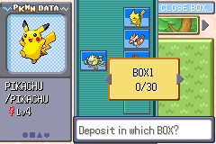

# 07 Pewter City

**Arrival.** From [Route 2](05_route_2.md): the north end of the route (11,0), arriving at (23,38) on Pewter's south side (map 36.2). 

## Map notes

- Pokémon Center door (17,25); Mart (28,18); Gym (15,16); two Museum doors (17,6) and (25,4); houses at (33,11) and (9,30).
- The Gym sits in a fenced loop: go up the east side past the Mart, then west along y 17-18.
- A scientist at (46,20) and the Gym guide at (42,20) stand on the east road. Both are scripted: see the story.

## Story

1. Heal at the Center (the mat inside is the entrance; the nurse heals the whole party and restores PP). We saved here.
2. The Mart stock: POKé BALL ¥200, POTION ¥300, ANTIDOTE ¥100, PARLYZ HEAL ¥200, AWAKENING ¥250, BURN HEAL ¥250, ESCAPE ROPE ¥550, REPEL ¥350. We bought three POTIONS (¥900). 
3. In the Mart: a youngster ("It's totally weak and it cost ¥500!", about a fish POKéMON) and a boy ("The shelves brim with all sorts of POKéMON merchandise.").
4. Walking onto (42,21-23) on the east road starts the **Gym guide's scene**: "You're a TRAINER, right? BROCK's looking for new challengers. Follow me!" He walks the player round to the Gym door and says "If you have the right stuff, go take on BROCK!"   The scene **repeats every time the player crosses x=42 until BROCK is beaten**, exactly as in FireRed (the scientist, who gives the CARD CASE in this build in place of the RUNNING SHOES, only appears after the badge).

5. At the Center's PC (stand at (11,3) facing up): SOMEONE'S PC, DEPOSIT POKéMON, STORE: the spare PIKACHU L4 went to BOX 1. The party keeps one POKéMON of each kind. 

## Everyone and every building

Done as the "speak to everyone, enter every building" pass (second visit).

- **Pokémon Center, 1F:** the nurse; a JIGGLYPUFF ("Puu pupuu!"); a gentleman on the phone ("TEAM ROCKET is at MT. MOON? Huh? I'm on the phone! Scram!"); a youngster by the Jigglypuff ("Yawn! When JIGGLYPUFF sings, POKéMON get drowsy... ...Me, too... Snore... I play POKéMON cards, too. Come back when you have a deck!", a card opponent for later); two boys at a table who are trading POKéMON ("I'm trading POKéMON with that kid there. I had two PIKACHU, so I figured I might as well trade one." / "I really want a PIKACHU, so I'm trading my CLEFAIRY for one."); the **Mystery Event Club woman**, who asks for the player's **profile** ("tell me about yourself... What's your profile?") and opens the Easy Chat editor. Pressing A through her prompt types words in ("GEODUDE A POKéMON FRIEND" got typed); cancel with B, then YES to "Quit editing?". The PC is at (11,2).
- **Pokémon Center, 2F** (stairs at (1,6): walk onto them from the east, pressing left): a **link room**. The attendant TEALA explains the WIRELESS CLUB: the UNION ROOM on the left (link up with nearby trainers) and the DIRECT CORNER on the right (trade or battle with friends, using a GBA Game Link cable if the Wireless Adapter isn't connected). Her explanation loops while A is pressed and the question "Is there something you needed to ask me about linking?" is answered YES; answer NO. The MYSTERY GIFT man and the other attendants lead to link features that can't be used here.
- **Poké Mart:** the clerk, and two customers ("It's totally weak and it cost ¥500!", about a fish POKéMON; "The shelves brim with all sorts of POKéMON merchandise.").
- **House (33,11):** a man ("An outsider is a POKéMON that you get in a trade. It grows fast, but it may ignore an unskilled TRAINER in battle. If only we had some BADGES..."), a boy and his NIDORAN♂ ("NIDORAN, sit!" / "NIDORAN♂: Bowbow!").
- **House (9,30):** an old man ("POKéMON learn new techniques as they grow. But some moves must be taught to them by people.") and a boy ("A POKéMON becomes easier to catch if it has a status problem. Sleep, poison, burn, or paralysis... Those are all effective. But catching POKéMON is never a sure thing!").
- **Museum of Science, west wing** (entered from the door at (17,6)): the ticket lady charges **¥50** ("Right, ¥50! Thank you! Please enjoy yourself."; walking to her desk charged it again on the second visit, ¥344 → ¥294); an old man ("I should be grateful for my long life. Never did I think I would get to see the bones of a dragon!"); the AERODACTYL and KABUTOPS fossil cases ("A primitive and rare POKéMON."). **2F:** a scientist ("This month, we're running a space exhibit."), a girl and her father ("I asked my daddy to catch me one! I want a PIKACHU! It's so cute!"), a man at the MOON STONE case ("MOON STONE, huh? What's so special about it? Looks like an ordinary rock to me."), an old man ("Humankind first set foot on the moon that day. I bought a color TV just so I could watch that news.") and the SPACE SHUTTLE exhibit.
- **Streets:** a fat man ("There aren't many serious POKéMON TRAINERS here. They're all like BUG CATCHERS, you know, just hobbyists. But PEWTER GYM's BROCK isn't like that, not one bit."); a bug catcher ("Psssst! Do you know what I'm doing? That's right! It's hard work!"); a lass ("CLEFAIRY came from the moon. That's what the rumor is. They appeared after MOON STONES fell on MT. MOON."); the museum guide ("Did you check out the MUSEUM? Weren't those fossils from MT. MOON amazing?").
- **Signs:** PEWTER CITY ("A Stone Gray City"); PEWTER MUSEUM OF SCIENCE; the police notice ("Thieves have been stealing POKéMON fossils from MT. MOON. Please call the PEWTER POLICE if you have any information."); TRAINER TIPS ("All POKéMON that appear in battle, however briefly, earn EXP Points."); the Gym sign ("PEWTER CITY POKéMON GYM LEADER: BROCK The Rock-Solid POKéMON TRAINER!").
- **Item:** a hidden POKé BALL at (6,3), in the grove at the north-west corner (found).
- **Not reachable yet:** the Museum's east wing (second door at (25,4); the amber exhibit, a scientist and the SEISMIC TOSS tutor), behind the Cut tree at (30,5); the scientist at (46,20) (after Brock). The Museum's MOON STONE case and Miguel (the Mt. Moon scientist) were not found.

## Party after

Unchanged; healed. Money ¥250 after the Gym's first trainer. Pokédex 4 caught.

## Bugs

None found in the game. Notes: the Easy Chat profile and link-room explanations loop when A is pressed through their questions (test-driver behavior, original FireRed). Everything reachable was tried except the items listed above.
