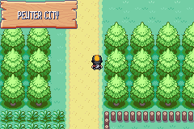
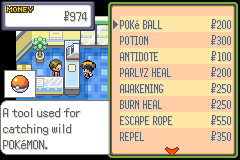
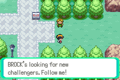
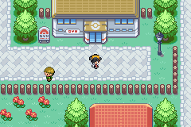

# 07 Pewter City

**Arrival.** From [Route 2](05_route_2.md): the north end of the route (11,0), arriving at (23,38) on Pewter's south side (map 36.2). 

## Map notes

- Pokémon Center door (17,25); Mart (28,18); Gym (15,16); two Museum doors (17,6) and (25,4); houses at (33,11) and (9,30).
- The Gym sits in a fenced loop: go up the east side past the Mart, then west along y 17-18.
- A scientist at (46,20) and the Gym guide at (42,20) stand on the east road. Both are scripted: see the story.

## Story

1. Heal at the Center (the mat inside is the entrance; the nurse heals the whole party and restores PP). We saved here.
2. The Mart stock: POKé BALL ¥200, POTION ¥300, ANTIDOTE ¥100, PARLYZ HEAL ¥200, AWAKENING ¥250, BURN HEAL ¥250, ESCAPE ROPE ¥550, REPEL ¥350. We bought three POTIONS (¥900). 
3. In the Mart: a youngster ("It's totally weak and it cost ¥500!", about a fish POKéMON) and a boy ("The shelves brim with all sorts of POKéMON merchandise.").
4. Walking onto (42,21-23) on the east road starts the **Gym guide's scene**: "You're a TRAINER, right? BROCK's looking for new challengers. Follow me!" He walks the player round to the Gym door and says "If you have the right stuff, go take on BROCK!"   The scene **repeats every time the player crosses x=42 until BROCK is beaten**, exactly as in FireRed (the scientist, who gives the CARD CASE in this build in place of the RUNNING SHOES, only appears after the badge).

## Party after

Unchanged; healed. Money ¥250 after the Gym's first trainer. Pokédex 4 caught.

## Bugs

None found. Interactions tried: Center, Mart, the Gym guide. Not tried: the Museum, both houses, the other townspeople.
