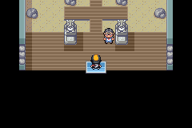
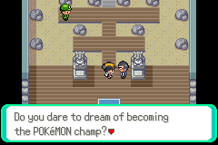
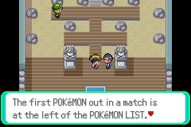
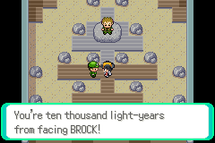
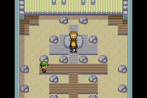

# 08 Pewter Gym

**Arrival.** From [Pewter City](07_pewter_city.md): the door at (15,16); inside at (6,14) (map 39.2). 

## Map notes

- A rock-and-ramp room: Camper Liam at (3,8), a gym guide at (7,12) next to the entrance, BROCK on his platform at (6,5). The way to him runs up the middle column x=6.
- Leaving: stand on the mat at (6,14) and press down. Walking down onto it is not enough.

## Story

1. The gym guy (7,12): "Do you dare to dream of becoming the POKéMON champ? I'm no TRAINER, but I can advise you on how to win. ... The first POKéMON out in a match is at the left of the POKéMON LIST. By changing the order of POKéMON, you may gain an advantage. Try different orders to suit your opponent's party." The last box closes only after a few more presses.  
2. **Camper Liam** (Geodude L10, Sandshrew L11): MANKEY in front with LOW KICK did most of the work; ¥176; MANKEY L12. 
3. Healed at the Center, came back, and stopped at (6,6), one tile below BROCK, **without talking to him**. The run was saved there: `saves/ethan_brock_door.sav`. 

## Party after

MANKEY L12 (LOW KICK, SCRATCH, LEER), PIKACHU L9, PIDGEY L5, CATERPIE L4, PIKACHU L4 (holding an ORAN BERRY). Bag: 7 POKé BALLS, 5 POTIONS, 5 ANTIDOTES, TEACHY TV. ¥250. Pokédex 4, 0 badges, 1:45.

## Bugs

None found. Not done on purpose: BROCK (Geodude L12, Onix L14 with TACKLE, BIND and ROCK TOMB). The next leg starts with that fight.

**Save.** `saves/ethan_brock_door.sav`.
