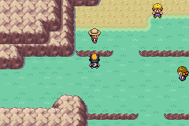
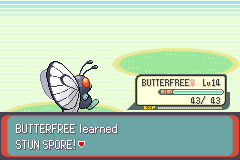

# 09 Route 3

**Arrival.** From [Pewter City](07_pewter_city.md): leave by the east road at (46,22) and step right; Route 3 (map 36.21) starts at (1,12) (after BROCK, with 1 badge). 

## Map notes

- A long east-west route (about 80 tiles) split by one-way ledges (they face south): the way from Pewter to Mt. Moon goes along the middle corridor and up to the top path through the gaps. Its north edge connects to Route 4 at x 60+; the grass patches are at x 36-48 (y 11-15) and x 70-78 (y 10-14).
- **The path planner stepped onto a ledge tile from below** here (it claimed U1 onto (12,7) was fine). Fixed in `path.py`: a ledge tile can't be entered except in its jump direction.

## Story

1. Eight trainers stand on the route, each beaten in turn with BUTTERFREE or MANKEY or PIKACHU in front (the lowest levels fight, the switch rule only as a safety net): **Colton** (CATERPIE L10 and others; ¥160), **Ben** and **Janice**, **Greg** (WEEDLE L9; ¥144), **Calvin**, **Sally**, **James**, and **Robin** (JIGGLYPUFF L14; ¥224). Total about ¥1400 (¥1694 → ¥3102).
2. **BUTTERFREE** gained levels fast: L14 (STUN SPORE, replacing STRING SHOT) and L15 (**SLEEP POWDER**, replacing POISONPOWDER). Each move-learning prompt stopped the auto-battle and was answered by hand. 
3. It got dark in the late fights (the route's palette follows the game clock).

## Party after

PIDGEOTTO L18, PIKACHU L15, BUTTERFREE L15, MANKEY L15: the spread is 3. Healed at the Route 4 Center afterwards.

## Bugs

None found in the game; one planner bug fixed (ledges). The youngster at (70,13) and the wild grass were not visited.
