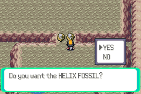

# 10 Mt. Moon

**Arrival.** From Route 4: the cave mouth at (19,5) leads to Mt. Moon 1F (map 34.1) at (18,37). Run so far: 1F finished, the Charmander quest done on B2F; B1F's east exit and [Route 4](11_route_4.md)'s east grass are next. 

## Map notes

- 1F (46x38): seven trainers, six item balls and a ring of breakable rocks. Ladders (5,6), (19,14), (31,16) lead to B1F.
- 1F: a bald man at (42,7) stands inside a ring of rocks: **Rock Smash is needed** to reach him (see the picture above).
- 1F: the corridor at (15,17) is only one tile wide, so a defeated trainer standing in it blocks the way; walk around the other side.

## Story

1. **Scientist Jovan** (¥264 prize; the fight left BUTTERFREE fainted and PIKACHU at 8/37 HP), **Bug Catcher Robby** (¥160), **Bug Catcher Kent** (¥176), **Youngster Josh** (¥160), **Hiker Marcos** (¥400), **Lass Iris** (CLEFAIRY L14; ¥224), **Lass Miriam** (ODDISH L11; ¥176): all beaten, MANKEY (L15 to L17) and BUTTERFREE (L15 to L18) doing the work; PIDGEOTTO stayed in reserve and gained L19 from Iris's fight.
2. Items on 1F: **RARE CANDY** (42,35), POTION (26,32), **TM09** (11,35), PARALYZ HEAL (2,22), **MOON STONE** (3,2) and an ESCAPE ROPE (44,21).
3. BUTTERFREE was offered SUPERSONIC at L18 (declined: it adds nothing the four moves don't cover).
4. The **ESCAPE ROPE** was used from B2F at the Rocket grunt's room to leave the cave: "ETHAN used the ESCAPE ROPE." The text box then sat on screen and the warp only completed after another A press (a small oddity; the player is put at Route 4's cave mouth at (19,6)).
5. The **RARE CANDY** went to PIKACHU, the lowest level: L15 to L16.

## B2F and the Charmander quest

1. **Rocket Grunt** at (18,27) above the corridor from the ladder at (17,31): beaten with PIKACHU leading (¥352). The rest of B2F (three more grunts, the fossil room with Miguel, TM46, a Revive, an Antidote) was not visited yet.
2. Walking along the passage to the STAR PIECE ledge starts the scene: a **wild CHARMANDER L10** (30 HP) is cornered at (32,30) and "is still glaring at ETHAN!" every time the player talks to it: it **respawns at full HP after any battle you don't win by catching**, so the fight can be repeated.
3. First two tries (a walk with the auto-switch rule, then a catch with the first-slot move) left the team nearly dead: the auto-switch rule rotated through MANKEY, PIKACHU and PIDGEOTTO, and the tool, with the bag open on ITEMS, threw no ball. **PIDGEOTTO, BUTTERFREE and then everyone else fainted** one by one; running away is possible (the forced "use next?" prompt answered with B).
4. The caught-it recipe: two POTIONS (PIKACHU and MANKEY healed to 22 and 26 HP), PIKACHU's **THUNDER WAVE** to paralyze it, THUNDERSHOCK twice to 3/30 HP, then a POKé BALL thrown by hand from the POKé BALLS pocket (only two balls were left): **"Gotcha! CHARMANDER was caught!"** The nickname screen opened (answer NO with B, then START/OK only if you want a name). 
5. The **STAR PIECE** sits on the raised ledge above the stairs at (30,26). Luna herself was not on screen afterwards: she is in the Route 4 Center (see [Route 4](11_route_4.md)).

## B2F, the rest (second visit)

- **The B2F cave is in separate pieces.** From the corridor ladder at (17,31) you can't reach the grunts: go up to B1F, along to 1F, to the ladder at 1F (5,6), B1F (3,3), walk to (22,18), and down to B2F (24,21), the big cave. Standing on an arrival ladder doesn't re-trigger it: step off and back on (`g R1 L1`).
- **Rocket Grunts** at (12,20) (a Rattata L13 team, ¥416; CHARMANDER led and was switched out, reaching L11 then L12) and (37,21) (¥416; MANKEY to L18). The grunt at (35,12) is on another ledge reachable from the (31,11) ladder: not fought.
- **REVIVE** at (24,6) (used on BUTTERFREE). **TM46** at (35,5) and the **ANTIDOTE** at (3,11) were out of reach this visit.
- **Super Nerd Miguel** stands at the foot of the fossil stairs at (13,11): "Hey, stop! I found these fossils! They're both mine!" A battle (**GRIMER L12**, poisons: MANKEY was poisoned and lost HP in the field until an ANTIDOTE) paid ¥288, and then: "We'll each take a fossil! No being greedy!" The player takes the **HELIX FOSSIL** at (14,7) ("Do you want the HELIX FOSSIL?" YES), and Miguel takes the DOME FOSSIL ("All right. Then this fossil is mine!"). 
- A wild **ZUBAT L8** (Pokédex +1) appeared as the player walked: weakened to 4/26 HP, caught with the last POKé BALL. 
- Out of B2F by the ladder at (5,10) to B1F (39,4) and the exit at (45,4): this is Route 4's **east** side, from where the road leads to Cerulean.
- **Team state:** no more POKé BALLS, PIKACHU and CHARMANDER fainted in the grunts' fights, so the party walked to **Cerulean's Center** (the Route 4 east grass was passed without catching: no balls).

## Party after

PIDGEOTTO L19, MANKEY L19, BUTTERFREE L18, PIKACHU L16, CHARMANDER L12, ZUBAT L8 (spread 11: the balancing is far from met; CHARMANDER and ZUBAT need fights). ¥5634. HELIX FOSSIL, STAR PIECE, MOON STONE (1 in the bag: the one from Luna's mother; the 1F stone at (3,2) did not show up as a second one), 3 POTIONS, 4 ANTIDOTES.

## Bugs

None found in the game. Process lessons: the catching tool throws whatever is under the bag cursor; mashing A on a shopkeeper buys, and on a card player starts a duel.

**Save.** `saves/ethan_charmander.sav` (Route 4 Center), then `saves/ethan_cerulean_arrival.sav`.
