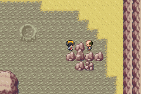

# 10 Mt. Moon

**Arrival.** From Route 4: the cave mouth at (19,5) leads to Mt. Moon 1F (map 34.1) at (18,37). Run so far: 1F finished, the Charmander quest done on B2F; B1F's east exit and Route 4's east grass are next. 

## Map notes

- 1F (46x38): seven trainers, six item balls and a ring of breakable rocks. Ladders (5,6), (19,14), (31,16) lead to B1F.
- A bald man at (42,7) stands inside a ring of rocks: **Rock Smash is needed** to reach him (see the picture above).
- The first-floor corridor at (15,17) is only one tile wide, so a defeated trainer standing in it blocks the way; walk around the other side.

## Story

1. **Scientist Jovan** (¥264 prize; the fight left BUTTERFREE fainted and PIKACHU at 8/37 HP), **Bug Catcher Robby** (¥160), **Bug Catcher Kent** (¥176), **Youngster Josh** (¥160), **Hiker Marcos** (¥400), **Lass Iris** (CLEFAIRY L14; ¥224), **Lass Miriam** (ODDISH L11; ¥176): all beaten, MANKEY (L15 to L17) and BUTTERFREE (L15 to L18) doing the work; PIDGEOTTO stayed in reserve and gained L19 from Iris's fight.
2. Items on 1F: **RARE CANDY** (42,35), POTION (26,32), **TM09** (11,35), PARALYZ HEAL (2,22), **MOON STONE** (3,2) and an ESCAPE ROPE (44,21).
3. BUTTERFREE was offered SUPERSONIC at L18 (declined: it adds nothing the four moves don't cover).
4. The **ESCAPE ROPE** was used from B2F at the Rocket grunt's room to leave the cave: "ETHAN used the ESCAPE ROPE." The text box then sat on screen and the warp only completed after another A press (a small oddity; the player is put at Route 4's cave mouth at (19,6)).
5. The **RARE CANDY** went to PIKACHU, the lowest level: L15 to L16.
6. The **Route 4 Pokémon Center** (next door) heals the party; the run was saved there.

## B2F and the Charmander quest

1. **Rocket Grunt** at (18,27) above the corridor from the ladder at (17,31): beaten with PIKACHU leading (¥352). The rest of B2F (three more grunts, the fossil room with Miguel, TM46, a Revive, an Antidote) was not visited yet.
2. Walking along the passage to the STAR PIECE ledge starts the scene: a **wild CHARMANDER L10** (30 HP) is cornered at (32,30) and "is still glaring at ETHAN!" every time the player talks to it: it **respawns at full HP after any battle you don't win by catching**, so the fight can be repeated.
3. First two tries (a walk with the auto-switch rule, then a catch with the first-slot move) left the team nearly dead: the auto-switch rule rotated through MANKEY, PIKACHU and PIDGEOTTO, and the tool, with the bag open on ITEMS, threw no ball. **PIDGEOTTO, BUTTERFREE and then everyone else fainted** one by one; running away is possible (the forced "use next?" prompt answered with B).
4. The caught-it recipe: two POTIONS (PIKACHU and MANKEY healed to 22 and 26 HP), PIKACHU's **THUNDER WAVE** to paralyze it, THUNDERSHOCK twice to 3/30 HP, then a POKé BALL thrown by hand from the POKé BALLS pocket (only two balls were left): **"Gotcha! CHARMANDER was caught!"** The nickname screen opened (answer NO with B, then START/OK only if you want a name). 
5. The **STAR PIECE** sits on the raised ledge above the stairs at (30,26). Luna herself was not on screen afterwards: she is in the Route 4 Center.
6. **Route 4 Pokémon Center:** LUNA ("How's the CHARMANDER? I'm glad it isn't alone in the dark anymore!") and her mother ("LUNA told me everything! You saved her from a wild POKéMON! Thank you so much! Please, take this. ETHAN received a MOON STONE from LUNA's mom. LUNA found it in MT. MOON. They say the CLEFAIRY dance around stones like that one. LUNA won't go into MT. MOON alone anymore. Thank you again!"): a **second MOON STONE**.
7. The Center's other people: the **MAGIKARP salesman** at (1,3) ("I'll let you have a secret POKéMON, a MAGIKARP, for just ¥500! So, you'll buy it, am I right?"; *my A presses accepted it: ¥500 for a MAGIKARP L5 nicknamed "AAAAAAAAAA", now in the PC*); a boy ("Okay, set six POKé BALLS in my belt... Yeah, that'll do it. At most, you can have six POKéMON with you."); a gentleman at (12,5) ("Not a day goes by without TEAM ROCKET being in the news. HIKERS play cards here, too. Care for a duel, young one?" and a **card duel against ANSEL** (SPEAROW / PIDGEY / ONIX+ on his side): forfeited); a youngster; the newspaper ("TEAM ROCKET attacks CERULEAN citizens...").

## Party after

MANKEY L17, BUTTERFREE L18, PIKACHU L16, PIDGEOTTO L19 and **CHARMANDER L10** (new; far below the rest, so the balance rule needs it raised). ¥4514. A Magikarp is in the PC.

## Bugs

None found in the game. Process lessons: the catching tool throws whatever is under the bag cursor; mashing A on a shopkeeper buys, and on a card player starts a duel.

**Save.** `saves/ethan_charmander.sav` (Route 4 Center).
