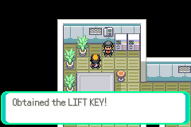
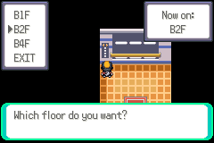
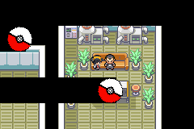
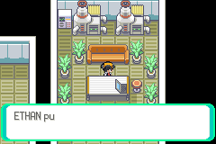

# 26 Celadon Game Corner and the Rocket Hideout

**Arrival.** From the Celadon streets ([page 25](25_celadon_city.md)) through the Game Corner door (34,21). Everything on this page is done except the Prize Room and the Gym.

## Map notes

- **Game Corner** (map 43.14): a 19-wide hall of slot machines (the signs say which are "OUT OF ORDER", "OUT TO LUNCH" or someone's keys), the coin clerk at the west counter, a **photo printer** (Pokémon Printer, ¥50, needs the TRAINER CARD) and, on the north wall, **the poster at (11,1)**. A Rocket **grunt at (11,2)** guards it ("I'm guarding this poster! Go away, or else!"; he is beaten for ¥640 and says "The TEAM ROCKET HIDEOUT might be discovered! I better tell BOSS!"). Pressing A at (11,2) facing up reads "Hey! A switch behind the poster!? Let's push it!" and a staircase appears at **(15..17,2)**: step onto (15,2) and press right to go down (the stair warps fire only when a direction is pressed on them). The exit is the doormat at the south: **only (9,13) works** (bug 2).
- **Rocket Hideout** (B1F to B4F, 34.42 to 34.45) and an **elevator** (34.46) with a floor panel at (0,2) (face up from (0,3)): floors B1F, B2F and B4F. Each floor's stairs also fire only when a direction is pressed on them.
  - **B1F:** the stairs from the Game Corner arrive at (12,2). The north part holds two grunts ((4,9), (24,12)); the stairs down at (17,2) lead to B2F; the stairs at (15,30) come back up from B2F into the south-west rooms (two grunts, the Hyper Potion); a **barrier at (20..21,19..20)** shuts off the south-east block (elevator doors at (23..25,25), the **Escape Rope (5,16)** is in the room at the far west reached from the south) until the grunt at (21,27) is beaten, and he can only be reached by the elevator.
  - **B2F:** a **spinner maze** (arrow tiles) fills the west; the grunt at (20,6) sits at the foot of the stairs to B3F (21,2); the room at (19..25,12..16) with the stairs (23,12) is how you get back to B1F's south. **X SPEED (15,3), MOON STONE (2,5), TM12 (5,7), SUPER POTION (0,14)** are in the maze. The elevator doors are (28..29,16).
  - **B3F:** a second maze. **RARE CANDY (12,12), TM21 (19,14), BLACK GLASSES (14,24)** and a hidden **NUGGET (1,3)**; the grunt at (19,9) blocks the east corridor and the one at (2,20) the south-west rooms; the stairs to B4F are at (15,18).
  - **B4F:** the **LIFT KEY** is dropped by the grunt at (4,2) ("Oh, no! I dropped the LIFT KEY!"); **TM49 (1,6), MAX ETHER (4,14), CALCIUM (6,23)**, hidden **NEST BALL (22,6)** and **NET BALL (16,6)**. **Giovanni** is in the room at (19,4) behind the barrier (17..18,12..14), which opens when the two grunts at (16,14) and (19,14) are both beaten (one stands on each side; the east one is reached by the elevator). After him the **SILPH SCOPE** lies at (20,5).
- Both mazes confuse the camera (bug 3): the tools copy the player's real tile into the position after each step and `rbfs.py` explores the real game with savestates.

## Everyone

- **Game Corner talkers** (ten people): "Welcome to ROCKET GAME CORNER! Do you need some game COINS?" (the clerk: **¥1 000 for 100 COINS**, bought once), "Keep this quiet. It's rumored that this place is run by TEAM ROCKET.", "They offer rare POKéMON that can be exchanged for your COINS. But, I just can't seem to win!", "The trick is to watch the reels closely.", "I think these machines have different odds.", "Wins seem to come and go. Nothing's a sure thing.", "These slot games... Win or lose, it's only by luck.", "Games are scary! It's so easy to get hooked!", a gambler who gives 10 or 20 COINS ("You don't need my COINS!" once you have plenty) and the gym guide ("CELADON GYM's LEADER is ERIKA. She is a user of GRASS-type POKéMON..."). **Twelve hidden COIN spots** (all found): (2,4), (3,8), (2,11), (6,12), (9,9), (8,5), (10,4), (13,3), (15,5), (17,5), (15,13), (12,12).
- **Grunts** (all beaten): B1F "Who are you? How did you get here?", "You broke into TEAM ROCKET's operation? What nerve!", "Intruder alert!" ("SILPH SCOPE? Humph! I don't know where it is."), "Why did you come here?" ("Okay, I'll talk... Take the elevator to see my BOSS."), "Are you lost, you little mouse?" ("Uh-oh, that ruckus somehow opened the door!"); B2F "BOSS said you can see ghosts with the SILPH SCOPE." ("The TEAM ROCKET HQ has four underground floors."); B3F "Stop meddling in TEAM ROCKET's affairs or else!" ("SILPH SCOPE? Oh, that machine the BOSS stole. It's here somewhere.") and "We got word from upstairs that you were coming!" ("But you can't run the elevator without the LIFT KEY."); B4F "The elevator doesn't work? Who has the LIFT KEY?", "I know you! You ruined our plans at MT. MOON!" and "How can you not see the beauty of our evil?".
- **Giovanni** (B4F (19,4)): "So! I must say, I am impressed you got here. TEAM ROCKET captures POKéMON from around the world..." **ONIX L25, RHYHORN L24, KANGASKHAN L29**; ¥2 900. "WHAT! This can't be!" ... "I see that you raise POKéMON with utmost care. A child like you would never understand what I hope to achieve. I shall step aside this time! I hope we meet again..." and he leaves (the grunts of Celadon go with him).

## Story

1. **Game Corner sweep** (`clearmap`): grunt, ten talkers, the twelve coin spots, the ¥1 000 purchase and a card-duel NPC (forfeited, see the bugs page).
2. **Opening the hideout:** poster at (11,1), stairs at (15,2).
3. **B1F** north rooms (two grunts); the barrier shows; **B2F** by the stairs at (17,2): the grunt at (20,6) by the stairs, then the maze. The static planner walked the maze like a plain floor and the player slid through it: this is how the camera desync (bug 3) was found, and why `goto` now uses `rbfs.py` on spinner maps.
4. **B3F** (two grunts, three items and the NUGGET); the **B4F** grunt at (4,2) drops the **LIFT KEY** ; the TM49 and MAX ETHER rooms; back up to heal in the Celadon Center (VENKMAN had fainted twice, WARTORTLE was at 3 HP).
5. **The elevator**  from B2F's (28,16): floor B1F to beat the grunt at (21,27) (which opened the barrier) and take the Escape Rope; floor B4F for the grunts at (19,14) and (16,14) (which opened the barrier), **Giovanni** , the **SILPH SCOPE**  and the two hidden balls. **CHARMELEON evolved into CHARIZARD** at L36 during the B1F fights (a goal reached). At the evolution my battle tool answered the move-learn prompt by itself and **CHARIZARD lost FLAMETHROWER to WING ATTACK**; at your request the moves were then restored with a save editor (`setmove.py`): CUT became FLAMETHROWER, WARTORTLE's RAPID SPIN became WATER GUN and DR VENKMAN's SPITE became HYPNOSIS, and the save was rewritten.
6. **Save** `saves/ethan_rocket_hideout.sav`.

## Party after

DR VENKMAN (GENGAR) L30, WARTORTLE L33, **CHARIZARD L36**, VENUSAUR L35, ALAKAZAM L34, PIKACHU L34. Money ¥30 793. Key items gained: **SILPH SCOPE**, **LIFT KEY**; TMs: TM12, TM21, TM49. The RARE CANDY was taken and is unused.

## Not done here

- The **Prize Room** (39,20) and the Gym (excluded by request); the **Pokémon Tower's 7F** and Mr. Fuji (the SILPH SCOPE is now in the bag).

## Bugs

- **#2** dead warp tiles (Game Corner (10,13), (11,13); elevator (1,5)), **#3** spinner camera desync. See [the bugs page](../playthrough_bugs.md).
