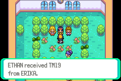

# 27 Celadon Gym (Erika)

**Arrival.** Gym door (11,30) at the south-west of Celadon ([page 25](25_celadon_city.md)). The road there is shut by Cut trees at **(52,22)** and **(40,35)**: they regrow whenever the map reloads, and the game lets you cut them by simply interacting with them (no party member needs CUT). Inside, three more trees at (6,8), (3,5) and (9,6) are cut the same way (A, then YES).

## Map notes

- A garden of trees and flowers with a sand cross in the middle. **(6,8)** is the tree that closes the inner garden; inside it, **Erika stands at (6,4) with LORI (5,4) on her left and LISA (7,4) on her right**, all reached from the row y=5 (the flowers at (5,6), (6,6) and (7,6) look walkable but are not: enter by the cut tree at (6,8)).
- Trainers (all beaten): Kay (Lass, BELLSPROUT L23, WEEPINBELL L23), Bridget (Beauty, four L21), Tina (Picnicker, BULBASAUR L24, IVYSAUR L24), Tamia (Beauty, two BELLSPROUT L24), Mary (Cooltrainer, five L22 incl. IVYSAUR), Lori (EXEGGCUTE L24), Lisa (ODDISH L23, GLOOM L23) and **Erika: VICTREEBEL L29, TANGELA L24, VILEPLUME L29**.

## Story

1. Healing at the Center first, then the two Cut trees on the road.
2. The sweep: Kay, Bridget and Tina fell to FLAMETHROWER (CHARIZARD led). The others sat behind the trees; opening (6,8) let Mary walk up, then Erika's intro text ("...Oh, I'm sorry, I had no idea that you wished to challenge me."). PIKACHU fainted to a VICTREEBEL; the battle was won with CHARIZARD (WING ATTACK), ALAKAZAM and DR VENKMAN. **CHARIZARD reached L37 and wanted CONFUSE RAY: you chose "don't learn it" (the tool stopped at the prompt and the answer was No, then Yes to "Stop learning")**.
3. **RAINBOW BADGE** ("It also allows POKéMON to use STRENGTH in and out of battle") and  **TM19 (GIGA DRAIN)**; ¥2 900. Lori and Lisa were fought from (5,5) and (7,5) afterwards.
4. Back to the Center, `saves/ethan_rainbow_badge.sav`.

## Party after

DR VENKMAN (GENGAR) L31, WARTORTLE L33, CHARIZARD L37 (FLAMETHROWER restored), VENUSAUR L35, ALAKAZAM L34, PIKACHU L34. Money ¥41 389. **4 badges.**

## Bugs

None found.
